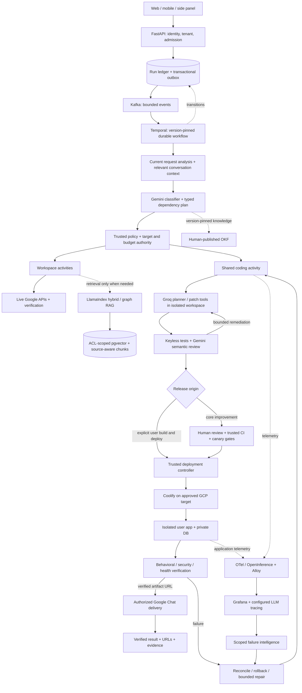

# September architecture reconciliation and implementation contract

**Current hosting status, 22 October:** the approved term has ended and the exact
Delhi VM is independently confirmed TERMINATED. Historical hosting/health proofs
below do not establish current availability. Local fixed scanner host dispatch,
native-proof binding and output recovery are implemented but not VM-installed or
live-proven. See [host launcher](RUNTIME_SCAN_HOST.md) and
[current billing/verification requirements](HOSTING_TERM_STATUS_2026_10_22.md).
No budget, hosting deadline, paid tier or protected allocation has been changed.

**Local orchestration checkpoint, 22 October:** migration 023 now supplies an
opt-in immutable reference-only Workspace event outbox, fenced publisher leases,
acknowledged Kafka adapter, SQL inbox deduplication and privacy/retention hooks.
Capture is off by default; nothing is production-migrated or started. A subsequent
local migration-024 checkpoint adds the registered SQL consumer, explicit new-group
bootstrap, manual offsets, rebalance cancellation, sanitized poison-record evidence
and exact privacy-digest tombstones. Coding-event capture, live broker/consumer proof,
lag alerts and Temporal single-owner migration remain open. See
[the outbox](WORKFLOW_EVENT_OUTBOX.md) and [consumer boundaries](WORKFLOW_CONSUMER.md).
The subsequent local migration-025 checkpoint bridges existing coding events through
the same bounded delivery plane, with a separate default-off flag, explicit v2 kind,
collision-safe source/run identities and privacy cleanup across both business ledgers.
Historical Workspace keys/bytes remain unchanged. This does not activate a coding
executor or prove live Kafka/Temporal behavior; see [coding events](WORKFLOW_CODING_EVENTS.md).

Status: source review complete; expansion authorized. Latest allocation approved
2026-09-19; Delhi VM and private Coolify bootstrap verified 2026-09-20. Full target
architecture remains in progress, not deployed merely because hosting is ready.
See `GCP_DELHI_HOSTING.md` and the resumed checkpoint in `project_progress_upgrade.md`.
On 27 September, the existing host gained a verified gVisor validation boundary.
Typed Rust-to-keyless-launcher integration is local, not production-activated;
see `ISOLATED_VALIDATION.md`. Source copies alone are not OS sandboxes.
On 6 October, local import-maintenance state was added to the shared host journal:
crash-persistent reservations block both validation and packaging and bundle mutation.
Read-only inspection remains available; expiry cannot clear an uncertain image load.
This is not live image enrollment or approval. Protected transfer/reconciliation,
real Node/Java gVisor proofs, verified publication and funded activation remain open;
see `OFFLINE_TOOLCHAINS.md` for the exact state machine and evidence boundary.
That journal barrier was subsequently VM-installed and independently rehashed;
the bound synthetic Python/replay/cleanup regression and six-container projected
health checks passed. At that checkpoint no import reservation was created.
The subsequent complete eleven-file operator custody gateway is VM-installed and
independently rehashed; both actual reviewed public React/Spring archives transferred
and passed a second persisted-file read-back without an exporter. Pre-load cancellation
retains their bytes/audit and releases maintenance; the main journal is idle and six
Coolify containers are healthy. The existing Python registry/policy and fixed STOP
are unchanged. A durable image loader, real Node/Java gVisor execution, role approval,
funded activation and the generated-app/Chat completion are still pending. See
`OFFLINE_TOOLCHAINS.md` for exact identities and the uncompleted enrollment phases.
The subsequent durable load-unit/outbox/reconciliation implementation is local,
with a complete twelve-file closure and bounded compressed install protocol. Real
process-death tests exercise claim/receipt/SQLite boundaries with mocked RPCs.
The VM still runs the eleven-file custody release; no load or approval occurred.

Latest verified follow-up (8 October, gateway rechecked 11 October): the full
fourteen-file `ca86020` closure is installed and independently rehashed. React
adopted its definitely completed restored image across a reviewed source handover
without another Docker load. All three fixed native gVisor cases passed expected
outcomes with verified cleanup; a separate reviewed publication enrolled React
test/build profiles and immutable provenance. This supersedes the historical
Node-toolchain-pending statements above for **React only**. It does not activate
funded user coding, Spring, Python-image recovery, runtime base images, core
production migration or generated-app/Chat delivery. See the current checkpoint in
`GCP_DELHI_HOSTING.md` and the retained receipts in `HOST_BUNDLE_OPERATIONS.md`.

Later on 11 October, native Spring diagnostics established a Maven/Javac
file-descriptor-limit failure. The reviewed Spring-only capacity correction and
actual guest-limit checks passed local regression (1,554 coding tests without skips)
and all three native Spring cases. The current fourteen-file `2f3ba14` closure now
has independently verified **React and Spring** profile enrollment, immutable image
provenance and cleanup; six Coolify containers remain healthy. Python-image recovery,
runtime bases, funded integration and complete generated-app/Chat proof are still
open. Toolchain enrollment is not activation of the whole target architecture.

## Sources and precedence

Both supplied texts were read through their endings on 2026-09-12:

- `41d45633-f9ba-4390-932f-777a5ed21bc8/pasted-text.txt`: 1,176 lines,
  267,333 bytes; SHA-256
  `a253d5d8bb14d0adfd868cffe3618a1485a7c0dfc355f12321a5a4872cc0fe0f`.
- `deploymentautomationstrategyforuserrequestcodedrepobycodingagent.rtfd/TXT.rtf`:
  SHA-256 `49601c74beaa4e39a69434d0ab04599f0eaeb8b9b1c433f44adc09100d58889a`.
  The complete text conversion is 2,274 lines / 100,611 bytes. Embedded images
  are small source icons and video thumbnails, not replacement architecture text.

The attachments contain historical user/assistant conversations, including superseded
and incorrect advice. The user's latest explicit decisions take precedence over older
assistant suggestions. Historical shell snippets, credentials instructions, billing
claims, and claims that a component is already running are not executable authority.

The original specification and Sprints 0–59 remain in scope. This expansion does not
erase their unfinished release, lifecycle-proof, and evaluation obligations.

## Final intent retained

1. Keep the core agent platform separate from applications generated for users.
   Do not migrate the existing Railway/Vercel/Neon production stack to a developer Mac.
2. Run self-hosted Coolify and generated applications on a GCP Linux VM, funded within
   the user's remaining trial credit and expiry. Oracle and an external paid VPS were
   considered earlier but are not the final selected target.
3. Support one durable compound request: generate a repository containing a React
   frontend, Spring Boot backend, PostgreSQL database and deployment configuration;
   validate it; deploy; verify real behavior; send its verified URL through Google Chat.
4. An explicit user build-and-deploy request authorizes that deployment inside a
   previously authorized tenant target, resource allowance, and cost envelope. Do not
   impose the core-platform candidate approval workflow on this user-service request.
5. Core-platform improvement candidates retain review, trusted validation, isolated
   canary, monitoring, and promotion/rollback. The shared coding engine has two callers
   with different authority; sharing an engine does not share their credentials.
6. Preserve Gemini router/Workspace roles, a Groq coding engine, a separate Gemini
   coding supervisor, and Gemini failure intelligence. Training and inference must be
   separate configured operations with honest cost and model-version evidence.
7. Include Kafka, Temporal, CrewAI, LlamaIndex, Langflow, RedisVL, Ollama, pgvector,
   GraphRAG/agentic retrieval, operational OKF, and unified MELT observability without
   giving multiple frameworks competing ownership of the same durable state.
8. Preserve local non-Git CLI operation, hosted GitHub App ingress, existing Workspace
   capabilities, exact conversation context, original safety/isolation requirements,
   and transparent UI progress and recovery.

## Corrections required before implementation

| Historical claim | Correct implementation constraint |
| --- | --- |
| Free Gemini SFT and free tuned-model hosting through AI Studio | Google currently documents no fine-tuning models in AI Studio/Gemini API. Use base runtime models or separately approved Vertex tuning and inference. |
| Managed Gemini tuning always costs a fixed number of compute minutes | Use the selected model's documented token/epoch pricing and actual job estimate; no guaranteed INR figure or run duration. |
| Quota of one job is a hard monetary cap | Concurrency limits and billing alerts are not monetary caps. Add application admission/reservations, expiry, and explicit cost authority. |
| Stopping a VM stretches trial credits beyond trial expiry | Credit expiry does not extend. Disks, retained IPs, snapshots and other resources may still cost money while a VM is stopped. |
| A second model or successful compilation proves correctness | They are evidence inputs. Independent behavioral, security, integration and deployment postconditions decide completion. |
| Temporal is a security sandbox and automatically writes business tables | Temporal owns workflow history. Activities explicitly write application projections; untrusted execution needs a separate OS-level boundary. |
| Kafka/Temporal imply unlimited concurrency, no loss, or zero CPU/RAM | Bound admission, partitions, payloads, worker capacity, queue retention and retries; test exhaustion/recovery. |
| Session UUID alone isolates tenants | Authorize by authenticated tenant/user on every run, artifact, graph edge, cache lookup and operation. |
| Ollama Llama 3.3 8B/3B produces required 4096-dimensional embeddings | Select a real embedding model; validate output dimension/version. Never reinterpret the existing index or silently force 4096 dimensions. |
| Coolify restarts automatically fix code | Coolify manages deployments. The bounded failure-analysis/coding/validation workflow proposes and verifies a fix. |
| An HTTP 200 proves a generated app works | Verify frontend, backend, database, authentication, intended user journey and URL delivery separately. |
| Root SSH plus AutoAddPolicy and interpolated shell writes is secure | Pin host keys, scope credentials/targets, use typed operations and safe file transfer; never interpolate model text into host shell commands. |
| The RTFD itself is a runtime deployment format | It is a requirements document. Runtime artifacts are validated source trees, manifests, images and Compose definitions. |
| A semantic cache hit can complete repeated mutations | Cached context/plans do not authorize or prove a fresh write. Use exact idempotency and live reconciliation. |

Verified references, checked 2026-09-12:

- [Gemini API fine-tuning availability](https://ai.google.dev/gemini-api/docs/model-tuning)
- [Managed model tuning pricing](https://cloud.google.com/gemini-enterprise-agent-platform/generative-ai/pricing)
- [Google Cloud trial limits and expiry](https://docs.cloud.google.com/free/docs/free-cloud-features)
- [Billing budgets and alerts](https://docs.cloud.google.com/billing/docs/how-to/budgets)
- [Temporal Python SDK and sandbox limitations](https://github.com/temporalio/sdk-python)
- [Coolify supported server installation](https://coolify.io/docs/get-started/installation)

## Proposed component ownership

| Component | Role and boundary |
| --- | --- |
| Vercel web / Flutter / side-panel client | Authenticate, submit, reconnect, display durable progress, clarify, authorize and inspect artifacts. Existing web/mobile surfaces remain; a side-panel distribution is a separate integration deliverable, not presumed shipped. |
| FastAPI | Public authenticated API, tenant authorization, admission, run IDs, idempotency and events; not Langflow. |
| Neon/PostgreSQL | Business run/step/event/artifact ledger, authorization, outbox, reporting, provenance, datasets, cache metadata and retrieval ACLs. Local development stays on local PostgreSQL. |
| Kafka | Bounded asynchronous event distribution from a transactional outbox; events carry artifact references, not raw secrets or complete prompts. Deduplicate at each consumer. |
| Temporal | One owner of each newly migrated durable workflow; deterministic workflow code, typed activities, deadlines, heartbeats, compensation and authenticated signals. Separate Temporal persistence/configuration from business tables. |
| Existing PostgreSQL worker | Rollback/control path during migration; never concurrently executes a run assigned to Temporal. |
| CrewAI | Bounded role collaboration within activities, with typed inputs/outputs; no independent deployment authority, global cross-user memory or unbounded retry loops. |
| Existing LangGraph | Preserve tested domain behavior through explicit adapters; do not nest competing execution loops. Audit each graph before migration. |
| Langflow | Private design/test surface. Exported graphs are versioned, validated and compiled through a supported adapter before runtime adoption. No arbitrary graph import as executable production code. |
| RedisVL | Optional bounded semantic-cache acceleration; tenant, entity, source, model, dimension, policy and OKF version keys; authoritative permissions and invalidation remain enforced. |
| LlamaIndex | Retrieval adapter for source-aware vector/hybrid/graph queries, with citations, lineage, ACLs, budgets, evaluation and tombstones. Not a replacement for authoritative live Google reads. |
| Ollama / pgvector | Explicit embedding contract, batching/backpressure, versioned reindexing and dimension validation. Existing embeddings remain readable until migration succeeds. |
| OKF | Human-published operational knowledge, version-pinned per run; registry policies remain authority. No raw incident becomes trusted knowledge automatically. |
| Rust broker | Bounded typed file, analysis, validation and operator tools shared by user coding and candidate engineering. Model processes never inherit host/deploy/database credentials. |
| Isolated execution service | Actually isolated untrusted build/test execution, resource limits, network controls, ephemeral storage and signed results. A temporary directory is not sufficient isolation. |
| GitHub App / local CLI | Scoped repository publication or private non-Git operation. No prerequisite that local folders be published. |
| Deployment controller | Trusted target registry, secret references, resource reservations, immutable release manifests, safe SSH/bootstrap and Coolify API operations. |
| Coolify on GCP | Isolated generated-app resources: React/Nginx, Java/Spring Boot with embedded Tomcat as appropriate, private PostgreSQL or explicitly provisioned tenant Neon DB. Never give apps the core database credential. |
| Observability | OTel/OpenInference at supported boundaries; Alloy transport; metrics to Prometheus/Mimir, logs to Loki, traces to Tempo and configured LLM trace backend(s), events/reporting to PostgreSQL. |
| LangSmith / Langfuse / Phoenix | Preserve current LangSmith; add requested Langfuse via deliberate exporter/backend configuration. Phoenix is an alternative evaluation backend, not a mandatory extra copy. Verify each backend's actual dependencies and costs. |
| Failure intelligence | Correlate exact tenant/app/release/run evidence, localize failure, choose bounded recovery or candidate flow. Core and generated-app incidents stay separate. |

## Runtime model and training contract

Latest clarification (2026-09-13): the user wants the roles assigned to AI Studio in
the source to stay there on its free tier, and Vertex roles to remain on Vertex. This
supersedes the earlier answer selecting paid Vertex for all Gemini roles. Free AI Studio
SFT is unavailable; do not silently substitute paid endpoints or label base models tuned.
The provider implementation supports both explicit backends but does not enable paid
calls by default or claim that new role workers have been wired into execution.

| Role | Requested base model/source | Training treatment |
| --- | --- | --- |
| Request analysis, classifier and planner | Gemini 2.5 Flash / Gemini Developer API | Base first pending decision; SFT dataset and evaluation are separate from weight training. |
| Workspace and composition agents | Gemini 2.5 Flash / Gemini Developer API | Same boundary; preserve tool contracts and per-call accounting. |
| Coding engine, including improvement candidates | `llama-3.3-70b-versatile` / Groq | Base inference, no claim that a normal Groq key changes hosted weights. Existing approved candidate-only fallback remains separately configurable. |
| Coding supervisor | Gemini 2.5 Flash | Semantic review grounded in source and independently produced test evidence; cannot declare compiler/test success. |
| Core and deployed-app failure intelligence | Gemini 2.5 Pro / Vertex | Explicit access, spending cap and activation required. No silent paid fallback from free runtime. |

Model IDs must be verified at the configured provider before release. The document's
temporary switch to Gemini 3.5 was later corrected; do not change models solely because
a newer model exists. Tuned deployments require exact resource/version identifiers,
not invented `tunedModels/...` paths.

SFT improves task-specific behavior but does not guarantee it. RLAIF here begins with
reviewed preference/critique data and offline evaluation. Actual supported preference/RL
training is a distinct operation, not simply a second model reviewing a patch. RLVR
(called RLAIV in the discussion) requires verifiable behavioral rewards, not merely
syntax acceptance. Groq-hosted base weights remain unchanged. Do not introduce a
Kaggle-trained local fallback: that earlier alternative was superseded by the Gemini
supervisor plus Groq coding choice.

No raw user mail, private repository, credential, or unconsented trace is exported for
training. Split datasets by provenance/task family to prevent evaluation leakage;
record consent, redaction, source version, correction evidence and retention. Free-tier
provider data terms must be checked before private data is sent. Training, tuned inference,
GCE hosting, storage, network and observability have separate budget lines.

## Target flow

One request may include clarifications for genuinely missing requirements. It must not
ask the user to repeat authorized steps, but cannot invent a target, budget, recipient,
credential, domain ownership, or security decision. Post-deployment ongoing repair needs
an explicit standing scope/expiry, not indefinite permission inferred from one deployment.

## Production invariants and acceptance

- Authenticate tenant and scope before every tool dispatch, event replay, graph traversal,
  secret lookup, deployment read/write and artifact delivery.
- Persist and pin run, session, tenant, application, source commit, image digest,
  deployment, model, prompt, policy and OKF versions. Do not use unbounded identifiers
  as Prometheus metric labels; keep them in protected traces/logs/business records.
- Reserve finite CPU, memory, disk, build slots, tokens, retries, cost and lifetime;
  enqueue fairly or return an actionable capacity result when exhausted.
- Validate generated Compose: no privileged containers, Docker socket, host mounts,
  host network, core secrets, public DB exposure or uncontrolled images/egress.
- Freeze source and validation evidence before release. Review is not runtime execution
  authority; compile, tests and security checks run outside model credentials.
- Each external mutation has an intent record, idempotency strategy, result artifact and
  reconciliation path for timeout-after-success. Never blindly recreate a DB or resend Chat.
- Test restart at every stage, duplicate events, expired approvals/targets, quota limits,
  auth errors, build failure, bad migrations, partial deployment and unreachable health.
- Login blueprint acceptance includes registration if requested, password hashing,
  session/token security, successful login, rejected invalid login, isolated DB persistence,
  frontend-to-backend integration, private secrets, TLS and actual recipient delivery.
- A failed first deployment has no previous healthy release to restore: clean up safe
  ephemeral artifacts, preserve required data and report failure. Do not invent rollback.
- Generated app recovery never mutates the core platform; core recovery cannot escape
  its governed candidate workflow. Neither may weaken tests to force completion.
- Completion UI distinguishes planned, built, tested, deployed, healthy, functionally
  verified and shared. A retained artifact or nonempty model answer is not task success.

## Outstanding decisions and access

1. Resolve free AI Studio roles versus unavailable free SFT. Base Gemini runtime there
   is the feasible compatibility path; supported tuned Vertex inference remains separate.
   The requested free SFT path is unavailable, not merely an absent credential.
2. Supply/verify GCP project ID, region, remaining credit, expiry, billing mode and
   authorized hosting/training allocation before provisioning. Historical project number
   `454922895512` is context, not proof of current access or permission to spend.
3. Confirm where persistent Kafka/Temporal/Redis/Langfuse services should run. The final
   documents preserve the existing core cloud stack; it is not established that its free
   allowance can also host these new persistent services. Stage locally without making
   production depend on the laptop, then approve a measured cloud footprint.
4. Obtain scoped GCP/SSH/Coolify/GitHub App access and domain authority when needed.
   Prefer short-lived identity and secret references; never paste credentials into chat
   or tracked documents. Do not upgrade billing or relax IAM automatically.

### Confirmed credit allocation, revised with explicit approval 2026-09-19

| Envelope | INR ceiling | Authority |
| --- | ---: | --- |
| VM and generated-app hosting | 14,000 | Initial 30 days only; Delhi e2-standard-4. Up to 3,000 explicitly reallocated from the original future reserve, using only the actual shortfall. Estimate including variable allowance: 13,850.56. |
| Future cloud deployment reserve | 6,000 | Remains protected; unused hosting earmark returns here. No additional automatic borrowing. |
| Vertex tuning, evaluation and tuned inference combined | 8,500 | Combined ceiling, not 8,500 for each category. |
| Total planned credit | 28,500 | Verify actual available credit and expiry before provisioning. |

These replace the provisional 70/30 split and supersede only the hosting/reserve
amounts of the 2026-09-13 allocation. Vertex remains untouched. Planning ceilings are
not billing hard caps; verify fresh credit and install controls before provisioning.
Do not extend credit expiry or treat the remaining reserve as available operating funds.

## Implementation order and truthfulness

Follow Sprint 60 onward in `project_progress_upgrade.md`. Start with contracts and
regression fixtures, then adapters and local fault-injection proof, then authorized cloud
provisioning and a limited end-to-end pilot. Preserve production rollback until parity is
proven. Apply the existing Karpathy/Ponytail rules: clarify assumptions, reuse proven
components, minimize new machinery, make narrow changes and demand executable evidence.

No claim of 100% correctness, unlimited free capacity, or guaranteed sub-10,000-token
solutions is an acceptance criterion. Record measured success, coverage, costs and known
limits. No production deployment or training job was performed during this reconciliation.

### 3 October 2026 — Image packaging ownership checkpoint

The existing build-artifact transfer and non-executing OCI assembly now have a local
durable job-authority ledger (migration 021), with tenant/run/validation/source/target/
runtime-policy binding, one-time dispatch, encrypted immutable results and separate
execution-versus-output-storage release. Build, validation and deployed-app obligations
share one funded capacity pool. A stale heartbeat never grants another execution;
an authenticated old receipt can be recovered by a new leased controller. Run deletion
scrubs private receipts while preserving outstanding cleanup obligations.

This is not a production worker or deployment proof. Actual keyless host execution,
durable output CAS, authenticated recovery/cleanup transport, registry publication,
protected signing, production migrations and generated-app end-to-end verification
remain open. See [OCI packaging](OCI_PACKAGING.md). The user-owned edits in
`docs/ARCHITECTURE.md` have not been overwritten by this checkpoint.

The following local checkpoint adds real bounded/private OCI output persistence and
fixed keyless worker assembly/observation logic, with exact envelopes emitted by the
job ledger. The worker CLI fails closed on an unenforced environment. Its guest-side
checks are not authenticated host/container proof: gVisor launcher/journal integration,
per-job mounted persistence, process reaping, result transport and live activation are
still required. Output removal explicitly does not release execution authority by itself.

The next local checkpoint shares validation and packaging intent in one host journal
and reaper, preserving legacy validation jobs and consumed dispatch identities. New
migration 022 records exact packaging-host identity and sanitized cleanup observations.
Registered-target/pinned-IAP recovery reconstructs the original binding without granting
another dispatch. A cleaned worker frees CPU/memory only; output disk remains held.
Late process observations reopen obligations, including after retirement. Cleanup
survives deletion/revocation/expiry but cannot prove successful assembly or publication.
This is local implementation, not a VM-installed packaging launcher or production
migration; per-job mounts, actual gVisor execution and authenticated receipts remain open.

The next local checkpoint implements the fixed root packaging launcher, private
per-job bounded filesystem/mounts, shared aggregate controller/guest cgroup contract,
and pinned IAP/SSH assembly/recovery/removal protocol. Its durable controller dispatches
once, retains uncertain obligations, recovers the original receipt and separates
execution from storage release. No arbitrary model-selected host command is accepted.
The complete bundle, operator cgroup, actual toolchain/runtime bases and live gVisor
enforcement remain uninstalled/unproven. Publication/signing, production integration,
funded enrollment and the full application demonstration remain open. Local tests
must not be represented as an active production image pipeline.

On 4 October the protected seven-file bundle was installed/read-back verified on
the same VM using a crash-recoverable operator transaction. Synthetic validation,
replay rejection and cleanup passed; the six Coolify containers remained healthy.
No packaging policy/cgroup or runtime approval, financial enrollment, production
migration or generated deployment was activated. The installer is a trusted operator
path, not a Rust/model command or candidate privilege. See
[host bundle operations](HOST_BUNDLE_OPERATIONS.md) for the exact evidence and limits.

Subsequent live nonsensitive observation exposed a real runsc contract mismatch:
the 16-task sandbox could not start, whereas 64 tasks allowed observation; guest
cgroup files were absent and virtual Seccomp was 0. The worker correctly remains
unactivated, but its current guest-only checks cannot support this runtime. Native
host process/cgroup verification and a host-controlled readiness handshake must be
implemented before private inputs are consumed. This finding does not authorize
unapproved native execution, a guard bypass or positive evidence from configuration
alone. Details and required runtime-wide correction are in `docs/OCI_PACKAGING.md`.

The subsequent local implementation adds a trusted native-kernel verification
callback and bounded readonly dispatch-bound readiness proof before worker artifact
consumption. It also persists container identity before removal and requires native
helper/resource-group termination before cleanup can release capacity. Unknown
identity retains the obligation; later helper observations invalidate prior cleanup.
Local decision tests simulate kernel/Docker observations and do not establish live
enforcement. This source revision is not installed on the VM; the native topology,
resource group, helper coverage and readiness/termination proof remain required.
CPU/memory limits stay at one CPU/3 GiB/no swap; the local measured-startup contract
uses 64 worker tasks and 128 aggregate tasks, not yet activated on the VM.

Subsequently, source commit `88e1ff7` was installed with independent full-bundle
read-back. The operator-created native aggregate's CPU/memory/swap/task values were
verified in the kernel without resizing the VM or changing its deadline. A fixed
nonsensitive live native probe showed correct scope membership, seccomp 2 and
no-new-privileges 1, but nonzero native runtime capabilities. The current guard
rejected that profile; private packaging is still disabled. Native namespace,
runtime role/capability and helper coverage need a proven contract before revising
the check. No new resource, financial activation, production schema or generated
application was created. See current evidence in `HOST_BUNDLE_OPERATIONS.md`.

The 4 October native profile correction is source-grounded, not a blanket
capability bypass. It pins the separate Sentry/Gofer binaries, proves Systrap
ancestry, compares the complete kernel process inventory, and preserves unknown
processes as failed readiness/uncertain cleanup. A live diagnostic identified the
optional unfiltered `runsc-fd-parking` sidecar. A reversible operator-only exact-hash
transition makes that optional binary non-executable; the pinned upstream source
explicitly supports its absence at the cost of slower teardown. Mandatory Sentry,
Gofer and guest isolation remain unchanged. Readiness independently checks the
exclusion so package/permission drift cannot silently restore it.

A nonsensitive post-exclusion native sleeper passed complete enforcement and
cleanup. This is not full OCI packaging or generated-app proof. Schema migrations,
funded production pools, approved Node/Java toolchains and runtime bases,
publication/signing, app behavior and final Chat delivery remain separate gates.
No new cloud resource, production schema, model call or budget expansion occurred.

On 5 October the next real component proof passed: fixed synthetic artifact/base
through the isolated worker's job-bound readiness barrier, OCI assembly, durable
output storage, independent host rehash, native termination and normal temporary
ext4 filesystem removal. A privacy-safe stage label located the prior failure at
the guest's missing `/sys/class/net`. The corrected runtime-specific check requires
both proc and socket enumeration to agree on loopback-only; a native worker still
requires sysfs and the host's network/namespace enforcement remains mandatory.
The protected operator installer now supports explicit exact-hash retirement of
obsolete rollback source copies, with durable intent and crash recovery. It never
prunes automatically or deletes job/artifact/deployment data, and preserves the
latest predecessor. See `HOST_BUNDLE_OPERATIONS.md` for read-back identities and
negative/positive evidence. Real React/Spring toolchains/runtime bases, funded
production dispatch, registry/signing and generated-app/Chat proof remain open.

On 6 October, fixed public React/Spring catalogs passed real local AMD64 Docker
offline positive/negative tests and build/package checks. Maven go-offline's dynamic
test-provider gap was reproduced and seeded using only public reviewed fixtures.
The validator source permits execution on bounded internal tmpfs for binaries/JNI;
read-only root, non-root user, network none, zero caps and gVisor are preserved.
Host-backed packaging storage remains noexec. The source was subsequently VM-installed
and independently rehashed on 6 October, followed by bound synthetic Python validation,
replay/mismatch rejection and cleanup. A final projected health check independently
verified six healthy Coolify containers, an idle journal and no scoped sandbox
containers. Installation alone was not treated as health evidence. Local Docker
is not Node/Java gVisor proof. Protected export/enrollment, native four-profile
validation, financial activation, signing/publication and full app/Chat proof remain
open. See [offline toolchains](OFFLINE_TOOLCHAINS.md). No new resource, model call,
budget expansion or production activation occurred. Existing VM usage continues to
consume trial credits. The original goal remains incomplete.

The next source checkpoint adds bounded streaming custody inspection for the two
real local toolchain archives, avoiding a large Mac output file while disk is low.
It independently binds every OCI blob, the exact source index, AMD64 platform and
configuration, with tagless compatibility metadata and closed graph membership.
Extended tar headers are rejected before their bodies can be allocated. This is
pure inspection plus a fixed exporter CLI, not Docker load, VM transfer, enrollment,
build provenance, approval or execution. Source scanner and fault tests exist;
protected host import and real Node/Java gVisor checks remain open.

### 12 October: legacy image restoration is a separate control-plane workflow

The legacy Python reload has been removed from the workload-critical path. A
source/config-bound operator controller uses `legacy_toolchain_restorations` in
the existing private host journal, under the same flock as validation and source
installation. Prepared/dispatched/uncertain recovery blocks new work and bundle
mutation; one write-ahead claim precedes the Docker RPC. Positive daemon receipt,
exact current image and exited matching unit are required for explicit terminal
reconciliation. Archive hashing and Docker input share one protected open inode.
This controller is not callable by generated code or an LLM and changes neither
image approval nor cloud allocation. Python positive/negative native probes,
replay and cleanup passed live. React/Spring remain enrolled. The implementation
does not complete runtime-base approval, funded dispatch or generated-app/Chat proof.

### 13 October: public runtime acquisition is separate from executable approval

A fixed source-reviewed catalog now acquires immutable public Nginx/Java 17 OCI
graphs into a private candidate store under pinned IAP, shared-journal ownership
and existing resource/time guards. Read-only observation rehashes actual retained
content and rootfs. Standard bounded string annotations are metadata, never hooks,
commands or approvals. An audited new plan links the earlier schema-rejected plan
without overwriting its history or changing catalog/configuration/STOP. Live
acquisition/readback passed; scanning, runtime-policy approval, actual image
publication/signing, funded dispatch and application/Chat proof remain open.
This does not integrate a fake runtime or silently switch away from Docker Desktop
for local private execution. See `RUNTIME_BASE_CANDIDATES.md` for source/host hashes.

### 13 October: verify the scanner before scanning a runtime

The operator control plane now acquires only pinned public scanner assets, verifies
their exact Sigstore signing identity/issuer and extracts one bounded ELF member as
non-executable data. The separate verifier environment does not alter production
dependencies and is given no application credentials. Its successful signature
check is not a vulnerability scan, executable-role approval or sandbox proof.
Pending execution must use keyless gVisor, a pinned fresh vulnerability database,
the actual OCI inputs and native limit/cleanup evidence. Protected hosting/model
budgets and the existing host source remain unchanged. Evidence and remaining
integration: `RUNTIME_SCANNER_PREPARATION.md`.

The next 13 October checkpoint completes actual private acquisition/readback of
both pinned Trivy data artifacts under the existing shared host ownership and
resource/deadline limits. A streamed parser rejects extension-header allocations,
unknown paths, links and changed/oversized prefixes. The database is a typed OCI
artifact, not an executable image; integrity/freshness does not grant runtime
authority. Keyless scanner invocation, native cleanup and complete CVE coverage
are still separate unfinished stages. See `SCANNER_DATABASE_PREPARATION.md`.

## Scanner custody checkpoint — 13 October 2026

The operator-only fixed IAP transfer now moves the previously signature-verified
scanner binary to the same VM as private non-executable data, with whole-file and
partial-prefix verification and immutable source-bound custody evidence. No model
can select its executable/path or convert that receipt into runtime approval.
See `SCANNER_BINARY_CUSTODY.md`. Existing host limits, deadline and production
boundaries are unchanged. Native scan/coverage/cleanup and runtime decisions remain
separate unfinished gates, alongside the full original upgrade obligations.

The following checkpoint adds operator-only `runtime_inventory`/`runtime_assessment`
ownership to the SAME host journal and native reaper; no second scheduler/slot or
model-selected command surface is introduced. Stable business keys, bound parent
inventory and explicit uncertainty prevent a crash, expiry or altered deadline
from replaying a scan. The tested complete host source is installed/read back as
`0d06e31b5b8b07faccdebc46bc0b508ad9aea3542a925de75f4597e755bb1a49`;
actual scanner launch, coverage and runtime approval remain unfinished. See
`RUNTIME_SCAN_JOURNAL.md`. Separate new-token Railway readback exposes an unhealthy
old production deployment, not a restored core; see
`RAILWAY_PRODUCTION_ACCESS_2026_10_13.md`. Core and generated-app authority/budgets
remain separate.

### 13 October: fixed scanner worker, no execution or approval claim

The next local implementation provides a standalone keyless two-stage worker with
closed source pins, exact OCI/SBOM lineage, fresh database checks, bounded subprocess
streams/deadlines and typed package/finding evidence. It uses one per-job writable
database copy rather than duplicating multi-GiB inputs, rehashes after execution,
and retains the container's 64-file-descriptor ceiling. Native cleanup and runtime
approval cannot be granted by its output. All 1,755 coding regressions passed with
loopback PostgreSQL; native staging/launch, report custody/coverage and actual scans
remain unproven. The VM source snapshot above is unchanged; this worker is not yet
installed. See [worker contract](RUNTIME_SCAN_WORKER.md). The older Railway workspace
was also queried without mutation; its mixed HOBBY/trial fields do not establish
available credit or eligibility for a free production restart.

### 24 October: deployment context and trial evidence are independent gates

The intended new Railway workspace is now resolved through token-context access,
and the operator confirms an unused $5 Trial Plan. Networking/capacity and a safe
production release remain unproven. The root build/upload ignore policies now
exclude local environment/provider state, private knowledge and backups; synthetic
Git-pattern tests passed, while actual Docker-engine CI remains pending. This does
not audit historical images or authorize a production startup/migration. See
[context boundary](DEPLOYMENT_CONTEXT_BOUNDARY.md) and
[conditional release plan](RAILWAY_TRIAL_RELEASE_PLAN.md). Hosting remains stopped;
core service boundaries and protected Vertex/reserve funds are unchanged.

The next local checkpoint adds schema-026 immutable run-owner bindings to the
actual Workspace/coding ledgers. Existing PostgreSQL workers filter owner before
claim and recheck live tenant/version/lease before credentials; SQL rejects old
workers' Temporal leases. Admission is default-off and current intake remains
PostgreSQL. Disabling admission never transfers an in-flight run. This is the
single-owner migration foundation, not an implemented or activated Temporal
executor. See [ownership contract and remaining work](WORKFLOW_OWNERSHIP.md).

Schema 027 then connects actual Temporal-bound inserts to a reference-only
transactional start queue and a bounded optional SDK adapter. Transport is
independently off. Lost responses reconcile one immutable workflow ID and exact
memo rather than reassigning the run or restarting writes. Parent erasure removes
private business data without erasing a pending start obligation; missing parents
cannot authorize fresh starts. Local SQL and SDK-double tests are not real Temporal
server/business/replay evidence. See [startup delivery](TEMPORAL_START_DELIVERY.md).

Schema 028 adds the actual first Workspace Temporal workflow and typed activities,
using the existing executor/verifier and private business ledger. A per-step
write-ahead journal blocks duplicate uncertain effects; history gets references,
not user content. Local SDK sandbox/activity and SQL tests verify the real
informational executor path, approval pins and truthful uncertainty handling.
No Temporal server/worker/admission is active; coding workflow, API signal delivery,
reconciliation, replay and live evidence remain open. See
[current Workspace bridge](WORKSPACE_TEMPORAL_EXECUTION.md).

25 October: schema 029 captures actual Workspace approval/clarification/cancel/
resume changes into a metadata-only coalesced refresh outbox. Nonce-fenced ACKs
preserve newer generations. The SDK adapter sends no authority/content and cannot
start/replace workflows. Capture is independently off; no publisher runs. Targeted
SQL/SDK-double and full migration rollback/forward tests passed; real signal/replay
and activation remain open. See [delivery contract](TEMPORAL_REFRESH_DELIVERY.md).

25 October: schema 030 appends immutable, expiring readback resolutions tied to
current source and original journal tokens. Resume preserves Temporal/canary pins
and does not repeat writes or erase uncertainty. It requires the full write
contract, matching plan, quiescence and pre-effect approval when required. Changes
invalidate proof; ordinary PostgreSQL behavior remains compatible. See
[verified recovery](TEMPORAL_VERIFIED_RECOVERY.md). Retry generations, compensation
and all live activation/replay gates remain open.

25 October: the shared tool-invocation path now checks a private trusted execution
context against live tenant/run/step/owner/version and PostgreSQL lease or Temporal
token/lineage/deadline. Cancellation and stale contexts stop new calls without
inventing provider failures. Worker cancellation preserves cancellation and does
not finalize replacement-owned work. This does not revoke in-flight RPCs or prove
atomic completion fencing. See [admission boundary](LIVE_TOOL_ADMISSION.md).

25 October, subsequent checkpoint: short SQL-only completion transactions now
lock and recheck live run/step/journal authority. Step outputs/artifacts/events and
Temporal journal outcomes commit together; run completion/retry/error events share
their state transaction. A completed write is not rerun to recover a lost final
summary: persisted receipts rebuild output with at most three metadata-only
automatic retries. Local fault-injection and SDK activity tests exercise these
boundaries, not live provider/server behavior. See
[atomic completion](ATOMIC_WORKFLOW_COMPLETION.md). Per-tool partial receipts,
safe retry generations, compensation and remaining original/60–68 scope stay open.

25 October, per-invocation evidence checkpoint: schema 031 and the shared wrapper
reserve bounded encrypted tool receipts before invocation, then save exact returned
responses independently of step completion. Uncertain acceptance is not false
success or permission to repeat. The actual authenticated resume handler uses
tenant-bound ordered receipts, deterministic readback, a rechecked observation and
full write contracts; Temporal proofs include restored artifacts in their source
digest. Private payload retention/erasure and reporting restrictions are explicit.
A fresh keyless subprocess crash and synthetic effect counter exercise recovery
without repetition. No live provider, server, migration or deployment proof is
claimed. Safe retry generations and unfinished-composite execution remain open.
See [durable tool receipts](DURABLE_TOOL_RECEIPTS.md).

26 October: schema 032 appends bounded, source-bound read retry generations to the
actual Workspace activity journal. The existing authenticated Resume flow issues
an expiring permit only for a current typed read plan, prior completed activity,
read-safe enforcement provenance and remaining persisted retry budget. The shared
tool boundary rejects writes/unclassified tools in read steps. New activity IDs,
tokens and callbacks distinguish generations; old uncertainty stays intact and
old deliveries cannot poison new work. This is not a write retry, owner transfer,
live activation or history-replay proof. See
[read generations and deployment limits](TEMPORAL_READ_RETRY_GENERATIONS.md).

26 October, real local server checkpoint: actual SDK startup/refresh adapters,
Workspace workflow/activities and private SQL were exercised against loopback
Temporal Server 1.32.0 (CLI 1.9.1, SDK 1.34.0). Five scenarios covered lost-start ACK,
worker restart/read generation, cancellation, erasure and persistent SQLite server
restart. Saved histories replayed both in-process and in a fresh offline process
after shutdown; an incompatible activity command was rejected. This supplies local
server evidence for those tested paths, not production availability, abrupt crash,
HA, real writes or cross-version rollout proof. CI now has an opt-in runner/evidence
step but no remote CI result is claimed. See [scope and artifacts](LOCAL_TEMPORAL_SERVER_PROOF.md).

26 October, prefix recovery: schema 033 connects the actual authenticated Resume
and PostgreSQL executor to exact, readback-verified ordered-prefix reuse. A
single-use grant binds the current plan, input/dependency evidence, approvals,
cohort, unchanged executor and encrypted receipt snapshot. The existing Sheet and
Chat typed helpers receive the original result without recreating the resource;
only the never-attempted suffix invokes a provider, then full readback decides
completion. Grant/queue/reconciliation event commit atomically. Unknown writes,
attempted suffixes, changed authority and Temporal write generations stay blocked.
This is local synthetic-provider proof, not production or exactly-once remote
transactions. See [details and rollout limits](VERIFIED_PREFIX_CONTINUATION.md).

26 October, schema 034: verified-prefix recovery now also creates a distinct
Temporal write generation through the existing authenticated Resume, activity
journal and shared step executor. Separate read/write permit guards, positive
prior quiescence, immutable nonce/source/actor bindings and current approval
prevent arbitrary retries or owner transfer. Unknown write and post-response
processing failures raise reconciliation decisions instead of inviting model
repetition. Seven real loopback server scenarios and their fresh-process offline
histories passed; write effects are synthetic and production remains inactive.
See [new path and unproven limits](TEMPORAL_WRITE_PREFIX_GENERATIONS.md).
