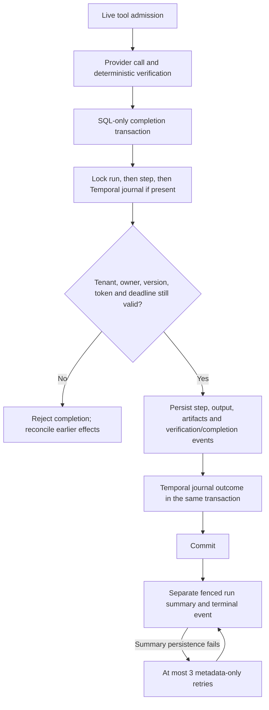

# Atomic workflow completion

25 October 2026. Local implementation checkpoint, not production activation.

The shared Workspace executor now distinguishes **permission to invoke a tool**
from **permission to commit its outcome**. A once-admitted RPC can finish after
cancellation, lease replacement or a Temporal journal becoming uncertain. Its old
worker must not overwrite the new authoritative state.

## Contracts

`app/runs/tool_admission.py` supplies short transaction contexts. The current run
row is locked before ownership checks; step completion locks run → step → journal.
The PostgreSQL lease must still match; Temporal must retain its executing nonce,
first execution receipt and activity deadline. Locks serialize cancellation and
lease transfer with completion. Acquisition/lock/statement waits are bounded.
No Google, model, network readback or other provider call occurs inside these
contexts. They are not application-wide locks.

`app/runs/worker.py` uses them for step outcomes, artifacts, run summaries, retry
state, terminal errors and verified-sibling reconciliation. Completion events use
`append_event_conn`, so an event insertion failure rolls back the associated SQL
outcome. Temporal step outcome and journal outcome now commit together; redelivery
after that commit observes success rather than inventing a new uncertain attempt.

Completion denials intentionally do **not** claim `provider_called: false`.
Earlier external effects might exist. This differs from denial immediately before
a tool invocation, where that specific invocation has not occurred.

Run output is rebuilt from all persisted completed steps in sequence order. A
restarted/resumed worker no longer drops earlier verified receipts just because
it did not execute those steps itself. Credentials are loaded lazily for a batch
that actually needs them, not for completion-only work.

If all steps are durably completed but terminal summary/event persistence fails,
the PostgreSQL worker can queue at most three automatic **metadata-only** retries.
The durable `result.completion_retries` counter and `completion_retry_scheduled`
event commit together, clear the lease, and explicitly record
`provider_reexecution: false`. The next owner finds no pending steps and rebuilds
the summary from committed receipts. Continued failure becomes a partial terminal
outcome for inspection; it does not loop forever or repeat a completed write.
If the database cannot persist even the retry transaction, lease recovery remains
necessary; this is not a guarantee of availability during a database outage.

## Local evidence

`tests/coding/test_tool_admission.py` uses disposable loopback schemas and actual
PostgreSQL row locking to check cancellation serialization, replaced-owner denial,
step/event rollback and Temporal step/journal/event atomicity. The actual shared
executor is exercised through SDK `ActivityEnvironment` in
`tests/coding/test_temporal_workspace.py`, including duplicate delivery after a
committed step but before its activity returns.

`tests/coding/test_pg_completion_fences.py` migrates a unique disposable local
database to the current schema and drives the actual PostgreSQL claim/executor.
Tests reject a terminal event insertion, verify that the run completion rolled
back, then recover only metadata while forbidding tool/model/credential calls.
Persistent failure exhausts exactly three retries and leaves no claimable loop.
Synthetic write receipts are test fixtures, not evidence of live Gmail delivery.

This checkpoint passed 36 focused SQL/SDK tests, 224 selected unit tests and the
complete coding regression (1,963 passed without skips, 82.58 seconds). Thirteen
warnings remain: one existing Google SDK deprecation and twelve existing
multithreaded-fork process-death probes. Targeted lint, medium-confidence security
and whitespace checks passed. The broader low-confidence Bandit check flags the
pre-existing static ownership-predicate SQL substitution; no user text enters it.
The complete unit suite subsequently passed 281 tests (one existing SDK warning).

## Limits and operation

No migration is added in this checkpoint. No default-off Temporal transport,
admission or publisher is activated. Existing user/provider approvals still apply.

Atomic local records are not exactly-once remote effects. An RPC may finish after
admission but before cancellation; a process may die before saving its result.
Durable per-tool partial-composite receipts, safe retry generations, compensation,
coding workflows and real Temporal server/replay/load proofs remain separate open
work. Existing verification/reconciliation remains mandatory for uncertain writes.
No production migration/deployment, VM restart or new spend occurred here.

See [live invocation admission](LIVE_TOOL_ADMISSION.md),
[verified recovery](TEMPORAL_VERIFIED_RECOVERY.md) and
[Workspace Temporal bridge](WORKSPACE_TEMPORAL_EXECUTION.md).
