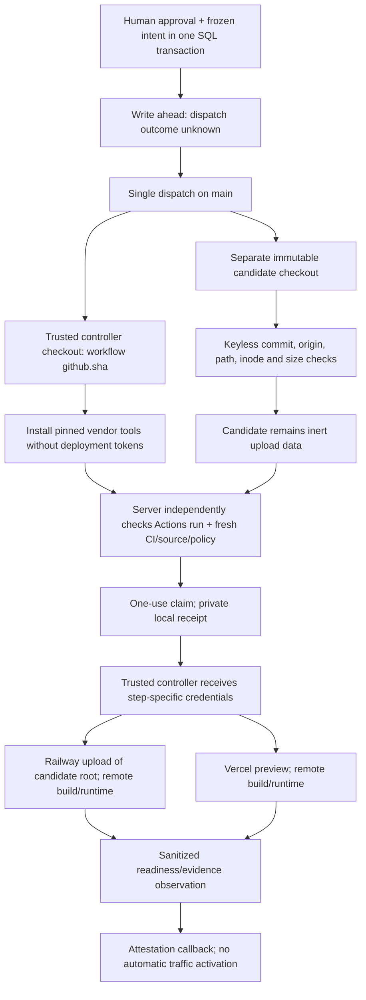

# Trusted candidate-deployment controller boundary

29 October 2026. Source/credential-boundary and local schema-037 journal checkpoint: no live deployment,
automatic-release completion or new cloud-spending authorization.

## Implemented boundary

- `candidate-deploy.yml` runs only on main. `controller/` checks out the workflow's
  exact `${{ github.sha }}`, never the candidate ref. `candidate-source/` is a
  separate immutable checkout with no persisted Git credentials, submodules or
  LFS. Inputs are environment data, not interpolated shell program text.
- Controller Python uses `-I` and a fixed trusted cwd. No candidate-owned script
  is invoked. The source preflight checks exact commit/origin, unchanged content
  and absence of **all** untracked files, including ignored private files.
  Only canonical regular files are accepted: no symlinks, submodules or hardlinks.
  Bounds: 20,000 files, 16 MiB/file, 128 MiB/tree, four-MB Git output and 20-second
  command deadlines. Git receives no provider credentials, user config or hooks.
- Railway CLI 5.71.0 and Vercel CLI 65.7.0 are installed before deployment
  credentials are present. No deployment-path `npx ...@latest` remains. Railway
  explicitly uploads the candidate directory with `--path-as-root` to an existing
  project/environment/service, excluding controller/link/credential state. See
  [the upload contract](https://docs.railway.com/cli/up).
- Vercel requires explicit project/team and reads that project back before its
  CLI write. The standard deployment operation handles remote-build source; no
  candidate install/build command runs locally. The existing owned-process helper
  bounds time/output and joins group/pipe cleanup, using a fresh HOME and narrow
  environment. The token remains a vendor-CLI argument, but controller failures
  never print argv or provider output. Runner/vendor trust is still necessary.
- Preview project, non-production target and candidate version are verified.
  Railway evidence retains only required identifiers/digest, not raw deployment
  metadata. These observations alone do not prove remote source provenance or
  application behavior.

## Actual evidence

Main CI at `4a68a2f` passed backend/web/mobile/Rust, including native Temporal
server/replay, audit, context exclusions and the production Rust build stage.
Candidate validation truthfully stopped in its migration **harness**: direct
script invocation could not import `app` for retention. It now uses
`python -m scripts.verify_cloud_migrations_local`; that actual module invocation
passed upgrade → downgrade 002 → upgrade 036 and empty-schema retention locally.
New native CI still must verify the correction.

**Subsequent verified result:** exact commit `b24491a20a9b193e4a393fab8d61b32a6b98902c`
passed both native [main CI 40858373770](https://github.com/agentic-ai-training/google-connector-app/actions/runs/40858373770)
and [candidate validation 40858373780](https://github.com/agentic-ai-training/google-connector-app/actions/runs/40858373780),
including all four jobs. This supersedes the pending native-check statement for
that commit only. The newer journal changes require their own source-bound CI.

Eighty focused tests passed using actual Git/inodes/isolated Python and synthetic
vendor operations. Poisoned candidate `json.py` is not imported. The real public
`4a68a2f` checkout also passed custody: 686 files, 6,253,373 bytes, no source
execution/upload. No actual vendor deployment was run.

## Schema 037: dispatch and claim custody

This is implemented locally in `app/improvements/deployment_intents.py`, not yet
production-migrated or exercised against cloud writes. It is separate from the
user-facing coding/deployment ledger.

1. Human code-canary approval and an immutable intent commit together. The intent
   binds the approval, proposal/content hash, build, exact candidate, repository,
   current CI policy, observed PR-base/controller SHA, isolated Railway target and
   runtime surfaces. An absent target rolls back approval rather than fabricating
   a deployment-ready state. Registry-only candidates retain their distinct path.
2. Dispatch rechecks current CI/source/policy/approval and pending canary under the
   shared lock order, then commits `dispatch_unknown` **before** the GitHub POST.
   Only a confirmed response advances to `dispatched`. Timeout, cancellation,
   process loss or a lost database ACK never resets the intent to `prepared`.
   Two concurrent dispatchers cannot both pass that transition.
3. Workflow input/run-name carries the intent ID. After keyless source checks,
   but before any Railway/Vercel credential-bearing step, the trusted controller
   requests a claim. The server independently reads the exact active Actions
   workflow/run: main ref, frozen controller SHA, workflow path/ID, repository,
   display title, `workflow_dispatch`, and **attempt 1**. Current CI and authority
   are checked again before one-use SQL claim. Moving main requires new review;
   silently rebinding an old approval is not allowed.
4. One response contains a random nonce; SQL retains only its SHA-256. The trusted
   controller saves it using exclusive creation, mode 0600 and fsync. A lost or
   malformed response leaves the claim uncertain and the local receipt unavailable;
   the job stops before provider writes. Rerunning the workflow cannot renew it.
   The receipt stays in `controller/`, never the candidate upload or test artifacts.
5. Deployment attestation rechecks current CI, consumes the exact live claim and
   matches run/source/target/surfaces/current human approval. The nonce is excluded
   from evidence and status responses. The workflow name supplied by a caller is
   not used as trusted identity. **This binding is not independent cloud-provider
   observation**; that remains necessary before calling the release fully proven.

The intent expires after at most one hour; a claim lasts 30 minutes. These are
authorization windows, not permission to extend hosting, change funding, or spend
from protected model/reserve budgets. Expiry does not prove remote rollback.

Admin endpoints:

- `GET /admin/candidate-deployment-intents/{id}`: state, timestamps, sanitized
  frozen authority, transition history and last observation; no nonce.
- `POST .../{id}/reconcile`: independently read Actions; no workflow/provider
  writes, retries, claim renewal or new permission. A complete bounded list and
  one exact matching run are required; zero matches is **not** proof of rejection.
- `POST .../{id}/cancel`: human `CANCEL_UNCLAIMED_DEPLOYMENT` plus a note, only
  before claim. This fences late claims, requests proposal changes and retires its
  pending canary. After claim it refuses to pretend remote effects are cancelled;
  independent effect reconciliation is required. Re-review is explicit, not an
  automatic retry. Proposal detail also exposes its intent summaries.

SQL enforces immutable authority, non-renewable workflow/claim identity, monotonic
state transitions and retained transition history. An occupied journal prevents
blind migration downgrade. Migration round-trip 037 → 002 → 037 passed against
an empty disposable database; this is not production migration or a backup drill.
The combined focused run passed 141 tests (19.27s), including actual SQL/admin
routes, bounded contention and concurrent dispatch. Targeted lint/security passed.
All GitHub/vendor calls in those tests were synthetic; no live claim was granted.

The subsequent exact clean checkout of code `ef71fb3` passed 2,659 tests, seven
separately gated Temporal-server skips and 14 existing deprecation warnings in
163.10s. No unraisable subprocess exception occurred. Only synthetic credentials
and disposable loopback databases were provided. A second actual migration proof
attempted downgrade with a retained journal: it refused, preserving schema 037,
the intent and its history. A redacted commit secret scan passed. New native CI,
production migration and independent cloud-provider readback remain unproven.

## Still required before live-safe autonomous release

- Reviewed workflow/action/vendor supply chains and immutable binary/provenance
  verification; pinned package versions alone are not attestation.
- Native CI and release validation for the new schema-037 journal, followed by
  production migration and governed real lifecycle evidence. Local tests do not
  prove a live Actions/vendor deployment or distributed exactly-once effects.
- Extend journaling to merge/promotion, per-effect provider operations, post-claim
  cancellation/revocation and cleanup. A one-use initial claim is not an immediate
  revocation check at every later provider operation. Vendor CLI retries and
  remote build/runtime behavior remain separate external-effect boundaries.
- Independent provider readback at attestation, post-merge trust, active-canary
  revocation and full rollback/cleanup reconciliation.
- Real upload/build/memory/network/capacity proof, approved funding/term controls
  and the complete fresh-canary measurement/promotion lifecycle.

Job/process timeouts are not spending caps or remote rollback. Preserve partial
or uncertain outcomes and reconcile; do not blindly rerun. No project, variable,
deployment, policy or canary changed here. The full original goal remains active,
including the separate user-facing coding/deployment service.
