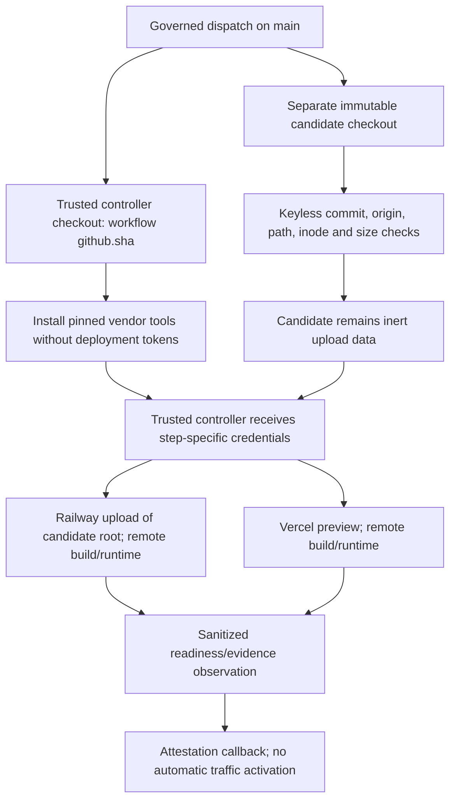

# Trusted candidate-deployment controller boundary

29 October 2026. Source/credential-boundary checkpoint only: no live deployment,
automatic-release completion or new cloud-spending authorization.

## Implemented boundary

- `candidate-deploy.yml` runs only on main. `controller/` checks out the workflow's
  exact `${{ github.sha }}`, never the candidate ref. `candidate-source/` is a
  separate immutable checkout with no persisted Git credentials, submodules or
  LFS. Inputs are environment data, not interpolated shell program text.
- Controller Python uses `-I` and a fixed trusted cwd. No candidate-owned script
  is invoked. The source preflight checks exact commit/origin, unchanged content
  and absence of **all** untracked files, including ignored private files.
  Only canonical regular files are accepted: no symlinks, submodules or hardlinks.
  Bounds: 20,000 files, 16 MiB/file, 128 MiB/tree, four-MB Git output and 20-second
  command deadlines. Git receives no provider credentials, user config or hooks.
- Railway CLI 5.71.0 and Vercel CLI 65.7.0 are installed before deployment
  credentials are present. No deployment-path `npx ...@latest` remains. Railway
  explicitly uploads the candidate directory with `--path-as-root` to an existing
  project/environment/service, excluding controller/link/credential state. See
  [the upload contract](https://docs.railway.com/cli/up).
- Vercel requires explicit project/team and reads that project back before its
  CLI write. The standard deployment operation handles remote-build source; no
  candidate install/build command runs locally. The existing owned-process helper
  bounds time/output and joins group/pipe cleanup, using a fresh HOME and narrow
  environment. The token remains a vendor-CLI argument, but controller failures
  never print argv or provider output. Runner/vendor trust is still necessary.
- Preview project, non-production target and candidate version are verified.
  Railway evidence retains only required identifiers/digest, not raw deployment
  metadata. These observations alone do not prove remote source provenance or
  application behavior.

## Actual evidence

Main CI at `4a68a2f` passed backend/web/mobile/Rust, including native Temporal
server/replay, audit, context exclusions and the production Rust build stage.
Candidate validation truthfully stopped in its migration **harness**: direct
script invocation could not import `app` for retention. It now uses
`python -m scripts.verify_cloud_migrations_local`; that actual module invocation
passed upgrade → downgrade 002 → upgrade 036 and empty-schema retention locally.
New native CI still must verify the correction.

Eighty focused tests passed using actual Git/inodes/isolated Python and synthetic
vendor operations. Poisoned candidate `json.py` is not imported. The real public
`4a68a2f` checkout also passed custody: 686 files, 6,253,373 bytes, no source
execution/upload. No actual vendor deployment was run.

## Still required before live-safe autonomous release

- Reviewed workflow/action/vendor supply chains and immutable binary/provenance
  verification; pinned package versions alone are not attestation.
- Server-bound single-use deployment admission/dispatch journal tied to current
  human approval, frozen source, target, CI policy and workflow run/attempt.
  Manual workflow dispatch does not consult that journal before cloud writes.
  Existing approval/attestation checks are not exactly-once dispatch.
- Independent provider readback at attestation, post-merge trust, active-canary
  revocation and full rollback/cleanup reconciliation.
- Real upload/build/memory/network/capacity proof, approved funding/term controls
  and the complete fresh-canary measurement/promotion lifecycle.

Job/process timeouts are not spending caps or remote rollback. Preserve partial
or uncertain outcomes and reconcile; do not blindly rerun. No project, variable,
deployment, policy or canary changed here. The full original goal remains active,
including the separate user-facing coding/deployment service.
