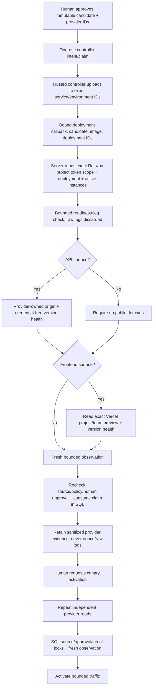

# Independent candidate-provider readback

29 October 2026 — local implementation; no production migration, provider write,
new credential installation, live deployment or traffic activation is claimed.

## Why a workflow callback is insufficient

A callback token authenticates a reporter. Its `verified: true`, image digest or
smoke-test list is not independent proof of a remote deployment. The server now
reads Railway and, when applicable, Vercel itself before consuming the one-use
deployment claim. It repeats those reads before explicit human traffic activation.
The current source-bound CI gate remains a separate requirement.

## Authority and target configuration

`app/improvements/provider_readback.py` uses an explicit server-only environment
configuration. It does not read `.env.local` automatically, inspect candidate
files, expose credentials through model settings, or fall back to old personal
Railway/GitHub tokens. Do not paste secret values into chat.

Server configuration:

| Variable | Purpose |
| --- | --- |
| `RAILWAY_CANDIDATE_PROJECT_TOKEN` | Token limited to the existing isolated candidate project/environment; API uses `Project-Access-Token` |
| `RAILWAY_CANDIDATE_ENVIRONMENT_ID` | Immutable environment ID, not the name `production` |
| `RAILWAY_CANDIDATE_SERVICE_ID` | Immutable service ID, not just a possibly reused name |
| `VERCEL_CANDIDATE_READBACK_TOKEN` | Dedicated suitably restricted readback credential; only for frontend candidates |
| `VERCEL_CANDIDATE_TEAM_ID` | Exact Vercel team/owner scope |
| `VERCEL_CANDIDATE_PROJECT_ID` | Exact existing candidate-preview project |

The existing `RAILWAY_CANDIDATE_PROJECT_ID` and candidate worker service name still
identify the configured isolated project/service. The intent freezes the additional
provider IDs with the approval. Credentials are not persisted in that intent.
Railway project tokens may have write capability within their provider scope;
the server verifier itself issues **only a fixed GraphQL query**, never a mutation.
This is not a claim that a token has a provider-enforced read-only scope.

The GitHub workflow additionally needs matching environment/service ID secrets.
Its existing Vercel project/team secrets must match the frozen IDs. Claim payload
and private receipt include only those identifiers, never provider tokens. Railway
link/upload/scale/variables and helper CLI operations target the exact service and
environment rather than resolving a mutable name. Missing/changed configuration
requires explicit correction/review; it cannot silently select another target.
No new resource is created to obtain these IDs.

## Independent checks and limits

- Railway project-token scope must match the frozen project and environment.
  The exact deployment must belong to that project/environment/service and still
  use the expected service name. Its status is `SUCCESS`, immutable image digest
  matches, all 1–20 reported instances are `RUNNING`, and the only active deployment
  is the reported one. An old active release cannot substitute during rollout.
- Provider creation time must be timezone-aware and no earlier than the bound
  claim. Future clock skew over two minutes is rejected. Cross-provider clock
  synchronization is an explicit assumption, not a distributed transaction.
- At most 200 startup-log records are examined for the exact candidate role and
  executor version. Raw logs, arbitrary metadata and provider error bodies are
  discarded; only a readiness boolean and necessary identifiers are retained.
- Worker-only candidates require zero service/custom public domains. An API
  origin must belong to the exact provider service and use its standard
  `.up.railway.app` domain. Custom domains are not silently allowed as health
  targets. Vercel must be a ready non-production deployment in the frozen project/
  team, have the exact candidate/proposal metadata and match its immutable preview
  hostname. An available Git commit metadata value must also match.
- Health requests are credential-free, HTTPS-only and confined to those verified
  provider-owned hostnames. No userinfo, ports, paths, queries, fragments, arbitrary
  IPs, cross-origin redirects or environment proxy inheritance is permitted.
  API/frontend health must return the exact role and version.
- Provider requests are fixed-origin, bounded to one MB; health JSON is bounded to
  16 KB. The overall independent read deadline is 40 seconds, individual request
  timeout 12 seconds, and SQL commit requires an observation no older than 30
  seconds plus the separately fresh CI snapshot. Failure grants no traffic and
  does not repeat an uncertain write.

Schema fields were checked with read-only Railway introspection on 29 October.
The pinned CLI 5.71.0's actual `EnvironmentInstances.graphql` selects `serviceId`
and `environmentId`; the readiness helper now filters those exact IDs. References:
[Railway API/authentication](https://docs.railway.com/integrations/api),
[deployment queries](https://docs.railway.com/integrations/api/manage-deployments),
[pinned CLI query](https://github.com/railwayapp/cli/blob/v5.71.0/src/gql/queries/strings/EnvironmentInstances.graphql),
[Vercel deployment API](https://vercel.com/docs/rest-api/deployments/get-a-deployment-by-id-or-url).

## What is still not proven

The combined focused suite passed **181 tests** in 19.79s, including actual SQL/
admin transitions, synthetic fixed-origin provider HTTP, blocked stale/mismatched
readback, no cross-origin credential leakage, and exact-ID CLI selection. Targeted
lint, security and whitespace checks passed. Those provider responses were test
doubles, not evidence of an actual cloud deployment. Full exact-tree/native
regression for this newer implementation remains required.

Independent provider state, metadata, startup logs and a version health response
are stronger than callback assertions, but not cryptographic build/source
provenance or complete functional/security verification. Keep trusted source
custody, CI, behavior tests, image provenance/scanning and isolated capacity tests.
Fresh checks before activation are not continuous active-canary revocation.
The bounded startup-log check can conservatively fail once readiness records leave
the available log window; it must not guess success. A durable structured worker
readiness/health channel remains a desirable follow-up, not a proven capability.
Promotion/merge dispatch and post-merge production readback still need their own
durable journal and independent proof. No new funding, billing tier, GCP hosting
term or protected allocation is authorized by this implementation.
