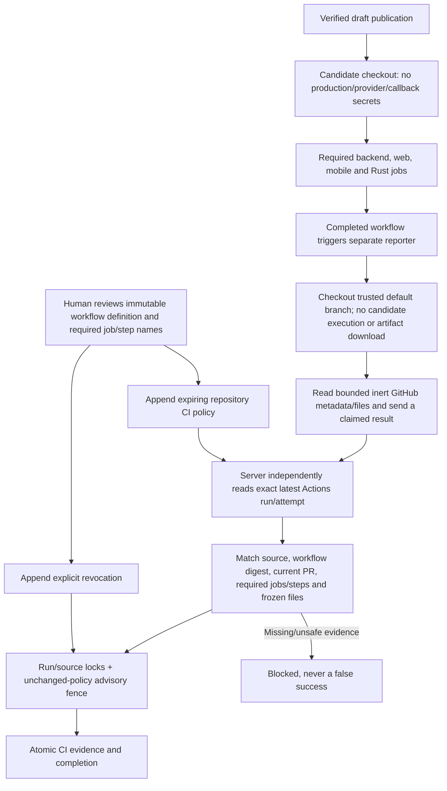
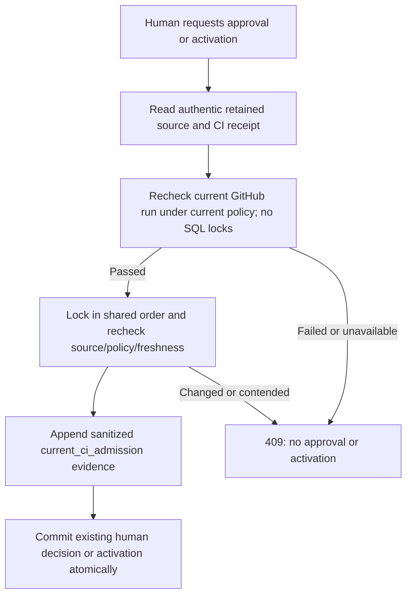

# CI trust, exact-attempt evidence and isolated reporting

Local checkpoint, 28 October 2026; schema **036**. No production policy is seeded,
no GitHub workflow is dispatched and no canary/promotion authority is granted.
That statement describes the original local checkpoint. The subsequent real PR
checks and their discovered failures are recorded below; neither run constitutes
production trust-policy enrollment or a candidate lifecycle proof.

## First real PR checks: false-green diagnosis and correction

PR #139 at `126f1cd477b60b1c7ef39850027c8ce86c4dd66a` produced main
[CI run 40715706533](https://github.com/agentic-ai-training/google-connector-app/actions/runs/40715706533)
and [validation run 40715706489](https://github.com/agentic-ai-training/google-connector-app/actions/runs/40715706489).
Web, mobile and Rust jobs passed in both. The main backend failed: 18 failed,
2,507 passed, seven skipped. Candidate validation incorrectly reported success
despite 18 failed, 2,462 passed and 52 skipped tests. Its brace group piped through
`tee` lacked `pipefail`: Bash exited the group at pytest, but successful `tee`
masked that exit. The later evaluations and Docker builds never ran.
**That green result is not valid release evidence.**

Backend/web/mobile validation gates now explicitly use Bash and `set -euo
pipefail`. Inert shell-execution tests inject a failure at every command position
and prove later commands never execute, the failure survives `tee`, and logs are
retained. Candidate backend enables the same integration suite as main CI.
Unraisable subprocess exceptions are fatal in both pytest invocations.

The 18 failures came from a test fixture using Linux's world-writable `/tmp` for
archives that correctly require protected ancestry. The fixture now uses an
isolated private directory beneath the operator's home, as existing custody tests
already do; the production guard is unchanged. A new negative test proves writable
ancestors remain rejected. Oversized diagnostic test IDs now have short stable
names, so verbose logs remain inspectable instead of embedding thousands of
parameter characters. A separate real Linux warning revealed pipe transports left
open after output-limit/cancellation cleanup; the owned-process lifecycle now
joins a public subprocess transport's closure as well as process exit. See
[execution fences](CODING_EXECUTION_FENCES.md).

Corrected native CI must pass at its own exact source SHA. These observations do
not authorize merge, deployment, production policy enrollment or canary traffic.

At the next commit `7f794eb09f804aa1b5f956cb7455d090014e9e51`, both the protected
exact-tree local run and candidate Linux backend passed **2,565 tests** (seven
Temporal-server cases intentionally run by their separate harness). The corrected
candidate workflow then correctly failed on four low-confidence Bandit SQL
construction reports; the frontend gate correctly failed its dependency audit.
Main CI's separate Temporal proof reached a genuine fresh-download 404 because
both SDK entry points supplied `1.9.1` instead of the upstream tag `v1.9.1`.
These were not retries of an unchanged source, nor evidence that the goal was
complete. Runs: [main 40719104252](https://github.com/agentic-ai-training/google-connector-app/actions/runs/40719104252),
[candidate 40719103872](https://github.com/agentic-ai-training/google-connector-app/actions/runs/40719103872).

Follow-up corrections preserve the audit gates. Next.js and its ESLint config are
pinned to 16.4.3, Sharp to 0.35.5, and compatible transitive fixes are locked;
`npm audit` reports zero vulnerabilities for that lockfile at this observation.
See the [Next.js advisory](https://github.com/advisories/GHSA-673q-mjm6-r5xr) and
[Sharp advisory](https://github.com/advisories/GHSA-rgj7-g3m4-5g8c). This is not
proof the current production deployment was updated or that all vulnerabilities
are discoverable. Both Temporal entry points now use the exact `v1.9.1` tag;
a regression test covers both. Its uncached Linux server/replay proof still must
run; SDK download checksum/supply-chain hardening remains separate work.

The four B608 findings were individually reviewed: two inject only the closed
schema-version ownership predicate (`TRUE` or `orchestration_owner='postgres'`),
one uses three fixed migration-dependent resolution predicates, and one appends
only the fixed `FOR UPDATE` suffix. Request/identity/executor values remain
parameter-bound. Narrow B608 annotations document those exact false positives;
no global rule/confidence/severity exclusion was added and no user SQL was allowed.
Ownership, retry and resolution PostgreSQL regression tests remain required.

## What changed

The former hosted worker accepted any nonempty collection of successful,
`neutral` or `skipped` check runs. It did not prove that a reviewed workflow or
the required tests ran. The candidate callback also accepted a bearer-authorized
`passed: true` report without independent Actions read-back. A callback token
authenticates a reporting caller; it cannot establish the claimed test outcome.



## Trust contract

- `coding_ci_policies` is append-only. A human administrator registers the exact
  repository, workflow ID/path, trusted definition commit, SHA-256 of its bytes,
  and required **display job names → display step names**. Policies expire after
  at most 30 days; newest disabled/expired trust cannot fall back to an older row.
  Updates/deletes are rejected, and retained policies prevent blind downgrade.
- CI obtains a separate short-lived GitHub App installation token scoped to the
  selected repository and read-only `actions`, `contents`, `pull_requests` (plus
  metadata). Returned scopes are checked. No write-capable legacy token fallback
  is allowed in this verifier. The publication controller keeps its separate API.
- The verifier reads only fixed GitHub API URLs with bounded responses and an
  overall deadline. It selects the latest run for the configured workflow and
  exact candidate SHA, accepts only same-repository `pull_request` execution,
  validates the current PR head/base and workflow bytes at both candidate and
  current base, then reads the **specific run attempt's** jobs. A stale successful
  run cannot mask a newer pending/failing run or a rerun.
- Every required job and named step must exist exactly once, be completed and
  conclude **success**. `neutral`, `skipped`, missing steps, wrong heads, duplicate
  identities and incomplete inventories do not pass. Non-required check names
  cannot substitute for required gates. Complete inventories are capped at 100
  runs/jobs; unsupported larger inventories block rather than silently truncate.
- Candidate file SHA-256s are calculated from actual bounded GitHub file content,
  not from submitted hashes alone. Commit/tree identity and the final run/attempt
  are read back. Per-file content is capped at 1 MB and aggregate content at 8 MiB;
  source paths must be canonical. Supporting larger files requires a separately
  bounded Git-blob path, not bypassing verification.
- Candidate success and remediation callbacks both use observed Actions evidence.
  Failure-job identities come from required gates, not arbitrary submitted labels.
  A failure outside reviewed required gates does not automatically generate a code
  patch. Posted commands, diagnostics and metadata are reports; the independently
  observed run/attempt/job/step record is stored separately as `github_observed`.
- Network reads happen **outside** SQL completion locks. Inside the transaction,
  run/tenant/source/publication pointers, candidate files, proposal identity and
  current policy are checked again. Parent/file/proposal locks stop source races.
  A per-repository transaction advisory lock serializes policy publication/revoke
  against final acceptance; observing the old policy before taking this fence
  does not permit completion after a revocation wins.
- Hosted CI's timeout begins at the recorded PR publication artifact, not an old
  request timestamp. Transient reads can retry within that existing deadline;
  missing App permissions, policy or invalid evidence require action, not blind
  provider retries or model calls.

## Keyless validation versus privileged reporting

`candidate-validation.yml` checks out the exact PR head, disables persisted Git
credentials, installs the optional orchestration dependencies, sets only synthetic
test database/auth values, and validates backend/web/mobile/Rust. Its obsolete
`015 (head)` assertion is replaced by the existing disposable migration-chain proof.
It no longer contains callback secrets or privileged reporting jobs.

`candidate-ci-report.yml` uses a completed `workflow_run` and checks out
`${{ github.sha }}`: the trusted default-branch revision for that event, **not** the
candidate SHA. Its small isolated Python reporter imports no project modules,
executes no candidate scripts and downloads no candidate archives/log artifacts.
Candidate manifests and content are inert bounded data fetched from GitHub.
GitHub and callback credentials use separate clients; neither client follows
redirects. The reported `log_digest` is explicitly a digest of **job metadata**,
not a claim that raw logs were downloaded or inspected.

GitHub warns that privileged `workflow_run` chains must not execute untrusted
code or poisoned artifacts. See the [event security warning](https://docs.github.com/en/actions/reference/workflows-and-actions/events-that-trigger-workflows#workflow_run)
and [GitHub's workflow security analysis](https://github.blog/security/application-security/how-to-secure-your-github-actions-workflows-with-codeql/).
The API facts used here are documented in [workflow runs](https://docs.github.com/en/rest/actions/workflow-runs),
[specific-attempt jobs](https://docs.github.com/en/rest/actions/workflow-jobs#list-jobs-for-a-workflow-run-attempt)
and [workflow identity](https://docs.github.com/en/rest/actions/workflows#get-a-workflow).

## Explicit human activation, not performed by this checkpoint

1. Publish/review the new workflow and reporter through the ordinary PR/CI process.
   The reporter must exist on the trusted default branch before its trigger works.
2. Confirm the scoped GitHub App installation has the three required read
   permissions. Keep App keys and callback tokens in their existing secret stores.
3. Review the immutable workflow bytes and obtain its GitHub workflow ID, trusted
   commit and SHA-256. Review both the commands and their referenced dependencies;
   a matching digest alone cannot establish test quality or supply-chain safety.
4. An authenticated human administrator may `POST /admin/coding-ci-policies` with:

   ```json
   {
     "repository": "OWNER/REPOSITORY",
     "workflow_id": 123,
     "workflow_path": ".github/workflows/candidate-validation.yml",
     "trusted_commit": "<40 hex characters>",
     "workflow_sha256": "<64 hex characters>",
     "required_jobs": {
       "backend": ["Validate candidate with no production credentials"],
       "web": ["Validate candidate web"],
       "flutter": ["Validate candidate mobile"],
       "coding-runtime": ["Validate candidate Rust broker"]
     },
     "ttl_hours": 24,
     "confirmation": "APPROVE_CI_TRUST_POLICY"
   }
   ```

   These placeholders are explanatory, not valid API hash values. The route
   verifies workflow ID/path and exact trusted-commit bytes before enrollment.
   Callback/builder identities cannot approve trust. No model or test fixture
   supplies production approval.
5. To withdraw trust immediately, a human administrator can `POST
   /admin/coding-ci-policies/revoke` with repository, current `policy_id` and
   `confirmation: "REVOKE_CI_TRUST_POLICY"`. This appends disabled trust and
   preserves history. An old policy ID cannot revoke a newly reviewed replacement.
6. A run blocked specifically for CI evidence may request `POST
   /coding/runs/{id}/recheck-ci` with its existing `action_hash`. Tenant/repository/
   feature gates, current policy and retained returned publication evidence are
   required. This queues **CI read-back only**, never execution/publication,
   cancelled-run revival, owner transfer or approval renewal. The frontend action
   and policy-management UI are still pending; these are API operations.

## Evidence boundary and remaining work

Real disposable PostgreSQL tests cover policies, advisory-lock races, actual
worker completion, candidate callbacks, revoked/replaced sources and truthful
outcomes. GitHub transport, token minting and reporter inputs are synthetic.
Reporter tests exercise its actual main function, inert malicious-looking source,
credential separation, malformed triggers and static no-secret workflow boundaries.
No real CI attempt, signature, runner isolation or production policy was proved.

Final verification on this worktree: **2,487 coding/unit tests passed without
skips in 85.34 seconds**; thirteen existing SDK and multithreaded-fork warnings
remain. All 115 focused CI/reporting/publication/fence cases also passed at the
preceding focused checkpoint (overlapping, not additional unique coverage).
Migration 036 passed upgrade → downgrade 002 → upgrade and empty full-schema
retention. Targeted Flake8, medium-severity/medium-confidence Bandit and whitespace
checks passed; pre-existing archive `nosec` annotation warnings remain visible.
No model call, live CI dispatch, production migration, policy enrollment, account
change, VM restart or paid deployment was performed by this checkpoint.

The human-reviewed definition/gates must still be evaluated for test sufficiency.
Mutable action/dependency pinning, an independent base-owned regression harness,
OIDC/signed provenance, workflow supply-chain review, log diagnostics in a separate
credential-free analyzer and live GitHub failure/recovery proof remain unfinished.
The subsequent code-admission integration below also checks current trust before
canary approval, activation and promotion approval. Deployment-controller trust,
post-merge attestations and stopping already-active routing after revocation
remain separate unfinished work; those are not guaranteed by these APIs.
No observed CI result authorizes merge, canary traffic, promotion, paid hosting or
private data egress. Coding Temporal integration and the full fresh candidate →
isolated canary → measurement → promotion/rollback proof remain open.

## Current code-candidate admission at human gates — 29 October

`app/improvements/ci_admission.py` is called by actual canary-review,
canary-activation and promotion-review endpoints. A nonempty `trusted_identity`
label, an administrator's `passed:true` registration, or an old green report is
not sufficient. For code candidates, the implementation requires:

1. One validated server build for the immutable candidate commit, a matching
   server-retained checkpoint report and passing attestation row.
2. Matching candidate/proposal digests, exact file sets, change types, content
   hashes and bytes. Files are bounded to 64, 1 MB each and 8 MiB in aggregate.
3. A retained, unerased linked coding publication when applicable, and an actual
   PR identity, not an invented branch or commit.
4. Fresh read-only GitHub verification under the current human-reviewed policy:
   latest run/attempt, actual required jobs/steps, current PR head/base, frozen
   files and tree. Remote requests happen before SQL business locks.
5. A short SQL-only admission transaction, in consistent lock order: linked
   coding run → policy advisory fence → build/files → proposal/files. Source,
   policy and report are checked again, with two-second lock/five-second statement
   bounds and a maximum 60-second observation age. Contention returns an
   actionable retry requirement rather than success or a model replan.



The evidence is appended to the existing `improvement_evidence` ledger and is
available through `GET /admin/improvements/{proposal_key}`. It records stage,
candidate digest/commit/build and observed policy/run/attempt. It contains no
source bodies, provider credentials or private user requests. A later failed
route validation rolls back both the evidence and the decision. This is an
internal audit record, not an email/GitHub publication or a new approval grant.
Rejections/change requests do **not** need fresh CI and never get blocked by an
expired policy. Existing non-code registry/OKF governance is unchanged by this
code-specific integration.

Real PostgreSQL tests and actual route calls cover valid admission at all three
stages, forged/missing receipts, changed content/hashes/heads/builds, newer policy,
stale observations, failed current required gates and contended row locks.
Synthetic GitHub transports assert read-only requests; merges/deployments are
forbidden or synthetic in these tests. No production policy is enrolled.

The exact committed code checkout `fe57211`, using the patched requirements graph,
passed 2,587 tests with seven separately exercised Temporal-server skips in 96.11s.
Its 14 SDK/TestClient/fork deprecation warnings remain visible; unraisable process
exceptions are fatal and none occurred. The resolved 150-package requirements
audit reports zero known vulnerabilities and `pip check` passes. PostgreSQL was
invocation-owned and removed after the run. This is local Python 3.14 proof, not
native Linux Python 3.12 CI or a production deployment claim.

This does **not** close the external-effect gap after SQL approval: durable
deployment/merge dispatch intents, independent controller/provenance verification,
independently observed deployment/post-merge proof and automatic revocation of
active traffic remain required. The subsequent controller checkpoint separates
trusted main-source scripts from inert candidate upload data and pins vendor
tools; see [the implemented boundary and remaining journal gaps](CANDIDATE_DEPLOYMENT_CONTROLLER.md).
That local source split is not a live deployment or a complete attestation chain.
No live canary or merge is authorized merely because these local tests pass.
