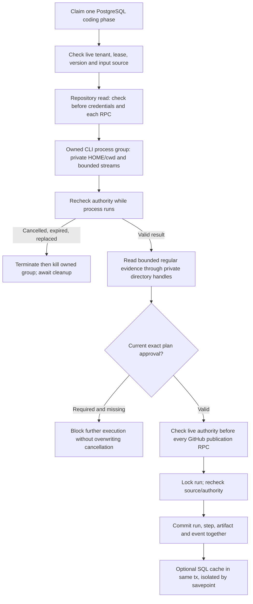

# Coding-phase authority and owned-process lifecycle

Local checkpoint, 27–28 October 2026. This hardens the **existing PostgreSQL-owned
hosted coding worker** before its Temporal activity migration. It is not a new
coding workflow, a replacement for the Rust broker or a production activation.

## Why this boundary changed

The old worker checked its lease at entry, then used `to_thread(subprocess.run)`
for a CLI that could run for 16 minutes. Cancelling the coroutine did not stop the
thread/child. A phase could also write step/artifact/events after its conditional
run UPDATE affected no rows. A lease token is not sufficient if it is checked
only before a long operation.

## Implemented invariants

- `execution_fence.py` rechecks tenant, visible run, PostgreSQL owner, live lease,
  phase/status, executor, repository/ref/commit, request/plan bytes and hashes,
  model/tool/OKF policy provenance, source-egress consent and attempt identity.
  Execution additionally requires current approval of the exact plan by its owner.
- Planning, execution and CI transactions use run-row locks and the same live
  checks. They cannot create contradictory success artifacts/events after a
  cancellation, changed source or replacement lease. Failure metadata also uses
  this fence; it cannot overwrite another owner's outcome.
- Expired execution approval stops work and records a blocked state only if this
  worker still owns the unchanged run. It does not invent success or assume that
  any earlier external effects are absent. Revoked approval state is preserved.
- `owned_process.py` starts an explicit POSIX process group, with no shell and
  closed stdin. It bounds time, retained stdout and discarded stderr. It monitors
  authority, cleans up the group on timeout/error/cancellation/success, waits for
  cleanup before temporary directories disappear, and withstands repeated parent
  cancellation. Cancellation during process creation also joins the owned spawn
  before cleanup. Unsupported process-group platforms fail before spawning.
- The hosted wrapper admits only fixed CLI verbs. A dedicated coding key may go
  only to `plan-request`; `execute-plan` and `doctor` reject a supplied model key.
  The environment is constructed afresh, private HOME and cwd agree, and the
  existing `GCA_REQUIRE_ISOLATED_VALIDATION=1` remains mandatory. Runtime/GitHub/
  database/cloud credentials are not inherited by the child.
- CLI response/evidence sizes are bounded before use. Evidence is opened beneath
  the exact private state directory using directory FDs, `O_NOFOLLOW` and bounded
  reads. Outside paths, symlink parents/leaves, hardlinks, FIFOs and oversized
  files are rejected rather than read as trusted plans or manifests.
- Hosted mutation paths must be canonical relative paths. Dot aliases, traversal,
  backslash paths and duplicate separators cannot evade the existing hosted
  infrastructure policy. Model-authored `.improvement-proposals/` manifests are
  denied; the trusted parent retains its separate governed manifest operation.
- Optional validation-observation caches are SQL-only and participate in the
  protected business transaction. A savepoint makes cache failure non-fatal.
  Rollback cannot leave a cache orphan, and tenant erasure cannot race a cache
  write after the business commit. Cached observations still cannot prove a live
  write, CI success, service health or deployment correctness.

## Evidence scope

The tests exercise actual disposable PostgreSQL, the actual planning/commit
functions, source/approval/owner changes, cancellation, transactional event failure,
optional-cache failure/rollback and the real user-erasure function. Synthetic
GitHub transport proves that lease replacement after one blob RPC prevents later
tree/commit/branch/PR mutations. No real GitHub publication occurred.

Real synthetic child processes exercise explicit environment/cwd, stdout/stderr
flood bounds, timeout, ignored TERM, parent/grandchild cleanup, lease loss,
ordinary/repeated cancellation, and cancellation during spawn. These trusted test
scripts are not model-generated programs and receive no real provider authority.

The existing native `gca-local` binary was also invoked through the new wrapper
with `doctor --workspace <temporary non-Git directory>`. It reported successful
local-private mode, `git_repository:false`, no model shell/credentials and mandatory
validation isolation. It explicitly reported `validation_isolation_verified:false`:
this is a diagnostic invocation, not compilation, validation or sandbox proof.

Final coding/unit regression: **2,389 passed without skips in 110.91 seconds**,
including 44 added fence/process/path cases. Thirteen existing Google SDK and
multithreaded-fork warnings remain. Targeted lint, medium-confidence/
medium-severity security and whitespace checks passed. Bandit still emits the
pre-existing archive `nosec` annotation warnings; these are not hidden or a claim
of a complete security audit. No project production service was started/deployed,
and this coding checkpoint made no GitHub publication, model/provider call,
cloud restart or paid allocation.

## Not yet proven or implemented by this checkpoint

- A coding Temporal workflow/activity/phase journal. These fences deliberately
  continue to reject Temporal-owned runs; do not emulate a PostgreSQL lease to
  call the old phase functions. The functions' SQL predicates need an explicit
  journal-bound adapter before that migration.
- Exactly-once GitHub publication or recovery of an in-flight/ack-lost external
  write. A fence stops **new** calls; it cannot undo a request already accepted by
  GitHub. Publication write-ahead evidence and source-bound reconciliation still
  need implementation before claiming full coding crash recovery.
- A trusted CI identity/required-check attestation redesign. This change fences
  the existing CI reader; it does not make its legacy check interpretation a
  complete deployment/promotion gate.
- Persisted cross-run planner checkpoints/budgets, coding compensation, immutable
  installed-CLI attestation, arbitrary cross-platform process isolation, remote
  container cancellation/cleanup and hard-crash/SIGKILL recovery.
- Live gVisor/Node/Java/private PostgreSQL generated-app proof, funded host restart,
  real model calls or production deployment. Process groups and a clean
  environment are **not** an OS sandbox for untrusted code.

The original upgrade scope remains active. See
[single-owner migration](WORKFLOW_OWNERSHIP.md),
[Workspace write generations](TEMPORAL_WRITE_PREFIX_GENERATIONS.md) and
[offline toolchain limits](OFFLINE_TOOLCHAINS.md).
