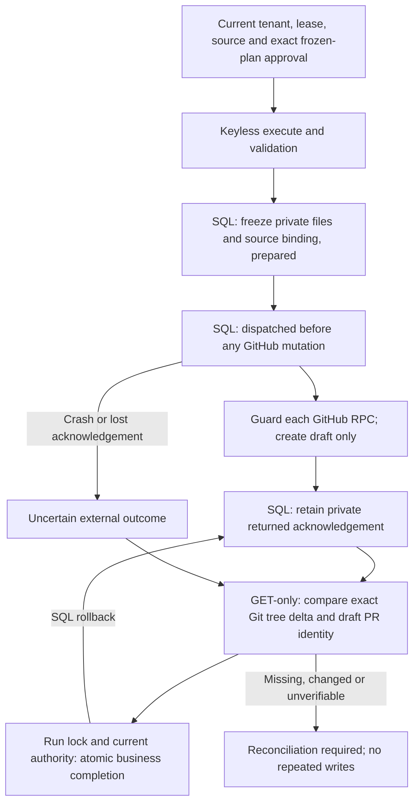

# Hosted coding publication: private intent, acknowledgement and read-back

Local implementation checkpoint, 28 October 2026; migration **035**. This extends
the existing PostgreSQL coding worker. It does not activate production, implement
the coding Temporal bridge, merge a PR or permit a deployment.

## The failure boundary

A GitHub draft PR can exist even if its HTTP acknowledgement or the following
local SQL transaction is lost. A lease check cannot undo an accepted RPC. Neither
an absent local PR artifact nor an HTTP timeout proves that nothing was created.
Previously the worker retained only temporary validated files and recorded the
publication after all remote writes, leaving this crash window unjournaled.



## Implemented contract

- One private receipt per run. Its immutable binding includes tenant, repository,
  ref/base commit, frozen request/plan, executor, model/tool/OKF provenance and
  source-egress consent. A replacement attempt may read the same intent, not
  replace its approved source. Receipt identity does not grant authority.
- Before first mutation, validated changed-file bytes and the server-authored
  candidate manifest are frozen encrypted with SHA-256 integrity, bounded to
  8 MiB serialized plaintext and a maximum 24-hour lifetime. Changed paths must
  be a subset of approved mutation paths. Governed candidate text is checked
  before publication, not after it has already reached GitHub.
- `prepared → dispatched → returned` is monotonic. Binding, dispatch timestamp
  and completed outcome cannot be overwritten. Database triggers constrain this;
  retained evidence prevents a blind downgrade. If a failed dispatch transaction
  leaves a verifiably `prepared` receipt, the existing bounded worker retry may
  use the same frozen files without rerunning validation. This exception does not
  apply after dispatch or when the database/source evidence cannot be checked.
- A `returned` receipt means **acknowledgement retained**, not verified execution,
  trusted CI, run completion, approval, promotion or deployment.
- The returning owner may preserve a late acknowledgement after cancellation or
  lease replacement. It cannot complete the old run. Changed source, tenant
  erasure or expired private evidence prevents recording/reusing that outcome.
- Recovery uses the saved file bytes instead of rerunning the planner, validation
  or publication. GET-only reconciliation checks the deterministic full-run-ID
  branch, commit parent, complete non-truncated base/head trees, exact approved
  file delta, open draft PR, repository, base ref, head SHA and canonical URL.
  Unexpected added/deleted/modified files are rejected. Tree directories are
  compared through their leaf entries rather than accepted as model prose.
- If dispatch occurred without a retained response, the same read-back may find
  an exact existing PR and capture it. An absent branch/PR is **not** evidence that
  an earlier call is no longer in flight. Recovery never recreates that branch
  or PR automatically. A branch without a PR remains uncertain/manual work.
- SQL completion still uses the live source/approval/owner fence. Run, step,
  artifact, linked candidate metadata and event commit together. A post-dispatch
  bookkeeping exception records `reconciling`, not a false success or a claim that
  the external write failed. Prepared/dispatched/acknowledged events contain only
  safe phase evidence; file contents and raw GitHub responses stay private.
- Reporting roles have no raw receipt access. Retention clears encrypted files
  and responses after expiry or soft erasure; hard run/user deletion cascades
  through receipts. Hashes alone are not permission to recover erased content.

## Owner-requested read-only reconciliation

An authenticated pilot owner can request:

```http
POST /coding/runs/{run_id}/reconcile-publication
Content-Type: application/json

{"action_hash": "<the existing exact 64-character plan hash>"}
```

The route requires the existing coding feature/pilot/repository authorization,
same tenant, PostgreSQL ownership, `reconciling` state, no active lease, matching
source-bound dispatched/returned receipt and still-current original approval.
It queues a normal fenced claim, whose saved receipt restricts it to GET-only
recovery. It **does not extend or recreate approval**, accept a prepared intent,
revive a cancelled run, permit model-generated writes or transfer workflow owners.
Repeated requests while queued conflict rather than create more jobs. If evidence
or approval has expired, leave effects intact and obtain a separately reviewed
reconciliation decision; do not edit SQL flags to fabricate success.

The endpoint is an implemented API, not yet a dedicated frontend action. No new
automatic polling of unresolved publications or implicit approval was introduced.

## Evidence and limits

Tests use real disposable loopback PostgreSQL and actual worker/route functions,
with synthetic CLI and GitHub transport. They cover late outcomes, erasure,
changed source, immutable receipt transitions, replacement leases, exact tree/PR
read-back, no-write missing-ack recovery, transactional event failure and
control-plane authorization. These tests are not real GitHub publication or
process-death/OS-sandbox proof. Existing process-death tests elsewhere do not
prove this new remote boundary. A real publication/crash exercise remains open.

Verification: the broader coding/unit checkpoint passed **2,428 tests without
skips in 118.59 seconds**. After the final prepared-intent retry correction, all
**40 focused publication tests passed in 3.51 seconds**. These are overlapping
checks, not 2,468 distinct cases. Thirteen existing SDK/multithreaded-fork warnings
remain. Migration head 035 passed upgrade → downgrade 002 → upgrade plus empty
full-schema retention. Targeted Flake8, medium-severity/medium-confidence Bandit
and whitespace checks passed; pre-existing archive `nosec` parser warnings remain.

Exactly-once remote transactions are **not claimed**. Uncertain partial publication
may require manual reconciliation. Trusted CI identity/required-check attestation,
coding Temporal phase journals, planner checkpoints, frontend recovery controls,
real sandbox/generated-app/Chat delivery and funded production activation remain
unfinished. Hosting budgets and stopped-resource authority are unchanged.
