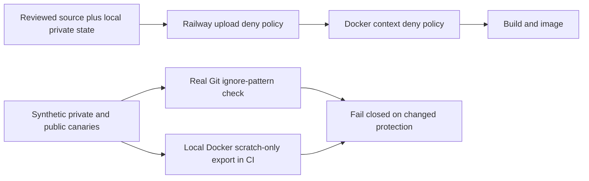

# Private upload and build-context boundary

Local checkpoint, 24 October 2026. The root Dockerfile uses `COPY . .`.
The previous ignore policy did not explicitly exclude `.env.local` and private
operator state. This is a source-policy defect; it is **not evidence** that a
previous image or upload contained secrets. Historical artifacts were not audited.

Both `.dockerignore` and `.railwayignore` now exclude root/nested environment
files, credential/OAuth JSON, token files, private keys, local operator/provider
state, private knowledge, backups and common database dumps/caches. Public runtime
source remains eligible. `.env.example` remains in Git but is excluded from builds.
Use reviewed committed source, not an arbitrary dirty worktree, for a release.

The stdlib-only `python -m scripts.verify_deployment_context` creates 30 private
and 10 public **synthetic** paths. It never reads/copies real environment files,
credentials or private project contents. Real Git `check-ignore` checks the Railway
pattern contract; this is not an actual Railway CLI upload proof. Policies must be
bounded regular files, contain the critical denials and have no negation rules.
Dockerfile-specific ignore overrides are rejected until separately reviewed.

`--docker` adds an actual Docker-engine test against that synthetic scratch-only
context. It pins a local Unix daemon/default builder, an empty Docker config and a
minimal child environment. No image pull, RUN step, provider secret or real source
upload is needed. The CI step is configured but not yet published/run; local Docker
engine proof has **not** been claimed. A missing engine fails, never passes by skip.

Eight focused tests and all 1,875 coding regressions passed locally with loopback
PostgreSQL. The standalone pattern audit passed. These
checks cover deny-pattern drift, negation, symlinks, oversized policies, overrides,
credential-free child invocation and sanitized errors. They are not universal
content-secret scanning: a secret under an arbitrary unrecognized name can still
leak. Release content scanning, explicit source review and real-engine CI remain
required. No Docker build, production upload, service start or secret rotation was
performed by this checkpoint.

References: [Docker contexts](https://docs.docker.com/build/concepts/context/),
[Railway uploads](https://docs.railway.com/cli/up).
