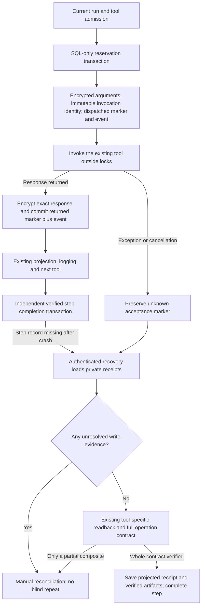

# Durable per-tool receipts

25 October 2026. Migration 031 and local runtime checkpoint; not deployed.

Step completion is too coarse to recover a composite operation if its first
external write succeeds and a later operation, logger or step commit fails. The
shared durable tool wrapper now records each invocation independently of the step
outcome. This applies to the existing deterministic Workspace helpers and guarded
agent tool calls, using the same wrapper and owner fences.

## Evidence, not success or authority

`dispatched` means the application reserved the invocation **before** calling the
tool. It does not prove Google received it. `returned` means the tool returned a
response, not that the requested operation succeeded. An explicit error mapping is
also a returned response. `unknown` records an exception/cancellation without
assuming that a remote write failed. Response-persistence failure leaves the
reserved record unresolved and raises a typed reconciliation error, not a false
provider-error ToolMessage or successful result.

Reservation holds run → step → journal locks only for SQL and rechecks the existing
owner/tenant/version/lease or Temporal activity token. `succeeded=None` admits this
metadata transaction without completing the activity journal. Tool/provider I/O
remains outside locks. Returned evidence may be captured after lease replacement
or cancellation, but cannot change business status or approve another call. Finish
uses run → receipt order and the exact opaque receipt/authority binding. Completed
receipt outcomes are immutable; an erased/deleted tenant cannot accept late data.

Call-ID reuse in the same step attempt is rejected before another tool invocation.
This is not semantic deduplication of arbitrary requests, automatic replay of a
stored response, or a new generation of permission to repeat a write. The existing
provider idempotency and readback contracts remain necessary.

## Privacy and bounds

Arguments and exact response use the existing rotatable application encryption
keyring. Their encrypted envelope binds receipt/run/step/tenant/tool/authority;
recovery checks both binding and digest. Worker lease values are hashed, not
persisted as plaintext credentials. No private result is put into receipt events,
Kafka envelopes, Temporal history or model prompts by this feature. Capturing
receipts adds no provider/model calls or public endpoint accepting receipt claims;
the existing authenticated readback still uses Google APIs when requested.

Each step has at most 64 reserved invocations across its attempts. A raw private
payload is bounded by the smaller of the existing configured limit and 2,000,000
bytes; SQL also bounds ciphertext size. Oversized input fails before invocation;
an oversized response cannot be called a safely recorded success. Capture and
lookup SQL waits are bounded. This is not a load-tested 1-GB service capacity claim.

Private payload expiry uses the existing retention setting, capped at 24 hours.
The retention job nulls ciphertext on expiry or soft erasure, retaining the
uncertainty marker/digest until the parent is deleted. Expired evidence cannot
authorize recovery. Hard run/user deletion cascades private receipts. User export
explicitly excludes them. Public, Grafana and DBeaver reporting roles receive no
raw-table privileges from this migration; reporting remains on approved views.
Existing task-log and step-data privacy policies are separate and unchanged.

## Actual recovery integration

The existing authenticated resume handler loads tenant-private evidence outside
the model path. It uses the ordered receipts instead of guessing a missing output
from an attempt's summary. Any unresolved/unavailable write record produces
`tool_receipt_write_outcome_uncertain` and blocks automatic repetition. Read-only
classification is conservative for calls inside a write step. A returned result
must still pass the existing full write contract and deterministic provider
readback. A created-but-unpopulated Sheet is not complete.

After external readback, the handler locks and rechecks the receipt snapshot. A
late response, expiry or erasure during observation conflicts instead of silently
accepting stale evidence. Saved step results use bounded projections, and verified
artifacts are restored for the existing recovery UI. For Temporal, those artifacts
are saved **before** hashing the final resolution source; saving them afterwards
would invalidate the new proof. Original journal uncertainty stays intact and the
source-bound proof remains independently expiring.

## Verification

`tests/coding/test_tool_receipts.py` exercises the real wrapper, SQL and resume
handler in disposable loopback PostgreSQL. It covers reservation/event rollback,
response loss, cancellation, duplicate IDs, stale-owner evidence, tenant binding,
immutable outcomes, bounded size/count, expiry/erasure, partial composites and
source-bound Temporal recovery.

A fresh keyless subprocess increments a synthetic durable effect counter, commits
its receipt and exits via `os._exit(41)` before any step completion. The parent
recovers through the real handler with synthetic Google readback, retaining exactly
one effect. This is a real process-death test, not a live Gmail/Sheets or Temporal
server proof. It starts no Docker, VM, model or cloud service.

The complete local upgrade → downgrade-to-002 → upgrade-to-031 chain and empty-data
retention integration passed. Downgrade refuses retained receipt records instead
of discarding evidence to produce a misleading green rollback. No production
migration or publication occurred.

Final verification: **2,264 coding/unit tests passed without skips** in 92.15
seconds. Twenty focused receipt cases are included; a separately selected final
347-test receipt/admission/Temporal/completion/unit run also passed. Thirteen
warnings remain from the existing Google SDK deprecation and twelve existing
multithreaded-fork process-death probes. This new crash probe uses a fresh process,
not fork. Targeted lint, medium-confidence security and whitespace checks passed.

## Rollout and open work

Apply schema 031 before running the new durable wrapper. Missing receipt schema
fails closed before provider invocation. Recovery remains compatible with old
schemas/data, but cannot retroactively invent missing receipts. Quiesce/replace
old workers during an approved rollout; they do not gain write-ahead evidence just
because the table exists. Protect the existing encryption keyring and test restore
before relying on encrypted evidence.

There is still a crash window between an external effect and saving its response.
An unresolved marker detects that window but does not resolve it automatically.
Safe retry generations, resuming only the unfinished part of a composite,
compensation, provider-specific unknown-outcome lookup, real server/replay/load and
funded deployment evidence remain open. No exactly-once distributed transaction or
universal automatic repair is claimed. The original goal remains active.

See [invocation admission](LIVE_TOOL_ADMISSION.md),
[atomic completion](ATOMIC_WORKFLOW_COMPLETION.md) and
[verified Temporal recovery](TEMPORAL_VERIFIED_RECOVERY.md).
