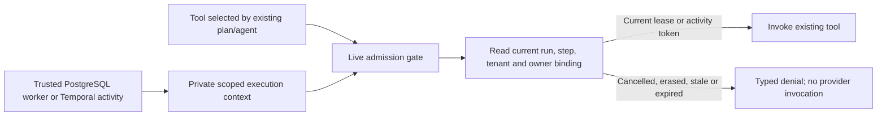

# Live tool admission and cancellation containment

Local checkpoint, 25 October 2026. The shared `execute_tool_call` path now checks
current durable execution authority immediately before invoking a tool. This is
service-independent: deterministic composites and LangGraph fallback use the same
gate. It adds no model call, provider fallback, OAuth scope or cloud resource.

The immutable in-process context contains the actual worker lease or activity token,
run/tenant/version, and the Temporal step, first execution and deadline when relevant.
It is not a model prompt, tool argument or RAG/OKF value. Workers scope/reset it;
parallel child tasks inherit their parent's context without sharing another tenant's
authority. Generated code remains outside this credentialed process.

Durable IDs must parse and match the trusted context. A bounded live SQL read then
checks run/step state, deletion, tenant, executor version and orchestration owner.
PostgreSQL requires its current matching unexpired lease. Temporal requires the
matching executing journal token and acknowledged first execution, an exact step
binding and an aware, unexpired activity deadline. Malformed/missing tokens or
deadlines fail closed. Database admission failure is sanitized and prevents a call.
The no-run legacy rollback path remains unchanged, but a durable context cannot
erase its run ID to become legacy.

Denial happens outside provider-error conversion. It therefore creates neither a
fictional tool attempt nor a provider-latency/error metric. It carries fixed typed
reason codes and `provider_called: false` for this invocation. This does not erase
earlier model calls or already-admitted tools in the same step.

The PostgreSQL executor preserves user cancellation, clears only its own lease and
marks running steps cancelled. Possible interrupted writes conservatively reduce
side-effect integrity to zero. A fenced stale execution returns without finalizing
a replacement owner's run. Temporal's cancelled outer workflow finalizes the ledger
before returning, so unresolved journal state is not bypassed by cancellation.

## Evidence and remaining boundary

Fifteen admission tests use small disposable loopback schemas, local provider
counters and real worker/tool-wrapper functions. They cover tenant/step mismatch,
cancel-between-calls, deletion, lease loss/expiry, owner/version changes, invalid
Temporal nonce/lineage/deadlines, child-context inheritance, sanitized DB failure,
actual worker cancellation and replacement-owner preservation, and Temporal
cancellation finalization. The selected admission/context/core/lineage suite passed
**245 tests** (one existing SDK deprecation warning); targeted lint/security and
whitespace checks passed. These are not live Google or Temporal server proofs.

After disk recovered to 5.8 GiB, the complete coding suite also passed **1,954
tests without skips** in 96.90 seconds. Seven warnings remain: the existing Google
SDK deprecation and six existing process-death probes forking after SDK thread
initialization. No hang occurred; process-isolating those probes remains work.

This is **invocation admission**, not atomic revocation of a remote RPC. Cancellation
can race after a successful check, and a request already on the wire may finish.
It does not undo effects or establish exactly-once execution. Atomic late-completion
write fences, durable incremental receipts for partially completed composites,
safe retry generations, compensation and full signal/server/replay/load evidence
remain open. Additional stale-denial event/monitoring coverage remains operational
work; not every denied context is claimed to have a dedicated persisted event.

No production deployment, provider/model call, VM restart, live admission/publisher
activation or budget change occurred. See [verified recovery](TEMPORAL_VERIFIED_RECOVERY.md)
and [Workspace Temporal execution](WORKSPACE_TEMPORAL_EXECUTION.md).
