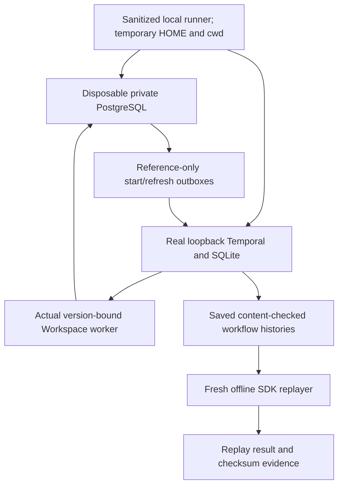

# Real local Temporal server and saved-history proof

26 October 2026. This checkpoint advances the actual server/replay evidence for
the existing Workspace workflow; it does not activate production Temporal.

## What was executed

The pinned optional Python SDK **1.34.0** ran against Temporal CLI **1.9.1**,
embedded Server **1.32.0**, on loopback. Ordinary cases used in-memory SQLite;
one used a temporary SQLite file and restarted the server. Private business state
used a uniquely created, fully migrated loopback PostgreSQL database, deleted
after the tests. No existing project/user database was migrated.

The real `TemporalStartTransport`, `TemporalRefreshTransport`, `WorkspaceWorkflow`,
typed activities, shared executor, authenticated resume helper and SQL journals
were used. Google and model calls were forbidden; tested operations were trusted
information responses and injected transient read failures, not real emails or
Calendar writes.

| Scenario | Evidence observed |
| --- | --- |
| Lost start response/ACK | Expired claim recovered by describing the same workflow; first execution unchanged, stale ACK rejected, one start event |
| Worker restart and read retry | First attempt stayed uncertain; explicit Resume issued generation 1; a real refresh signal queued while the worker was stopped; new worker completed the read |
| SDK cancellation | Real cancellation finalized the business ledger as cancelled and preserved uncertainty; cancelled history replayed |
| Private erasure | Deletion captured a real refresh hint; the workflow returned `deleted` without recreating the ledger |
| SQLite server restart | Server stopped and reopened the same SQLite file; first execution ID survived; existing refresh/resume path completed |

The final histories contained **35, 71, 47, 47 and 71 events**, respectively.
All five replayed through the SDK. A second fresh process replayed their saved JSON
after workers, servers and PostgreSQL test fixtures had stopped. An intentionally
changed activity type was rejected by the replay gate, producing an **expected**
nondeterminism diagnostic. Positive replay is not merely accepting a stored
`replay_passed` flag.



## Reproduce

Install the existing project dependencies plus `requirements-orchestration.txt`,
then use a disposable-database-capable **local** PostgreSQL account:

```sh
COST_LEDGER_TEST_DSN=postgresql://127.0.0.1:5432/postgres \
  .venv/bin/python scripts/verify_temporal_server_local.py
```

The runner refuses non-loopback DSNs and query/fragment options. It creates a
temporary HOME/cwd and forwards only an explicit environment allowlist: no model,
GitHub, Railway, GCP, telemetry authentication or developer database variables.
Repository `.env` files are not loaded from that temporary cwd. A cached compatible
CLI is reused when present; otherwise the SDK can download the specified public
CLI version. That dependency download is not a provider/model call.

The test process owns a separate process group. Timeout and ordinary termination
cancel it and stop that owned group; unexpected leftovers fail the proof. Normal
server shutdown is checked by probing the former loopback listener. Hard SIGKILL,
OS failure and machine power loss cannot be handled by a Python cleanup handler.
This is environment isolation for trusted tests, not an OS sandbox for arbitrary
generated code; the separate coding broker/container isolation remains necessary.

Results are in the ignored `.gca-local/temporal-proof/<timestamp>-<nonce>/` folder:
five history JSON files, their small metadata/checksum files, and JUnit XML. A final
observed proof directory was:

```text
.gca-local/temporal-proof/20261026T055247Z-436ed4e8/
```

Saved histories exclude the synthetic private task marker, synthetic user identity
and product-answer content. This tests the reference-only boundary, not every
future payload type or every privacy adversary. Metadata checksums detect mismatch;
they are **not signed CI attestations or authority to deploy/promote**.

To repeat only the offline check from the repository root:

```sh
PYTHONPATH=. .venv/bin/python scripts/replay_temporal_local_proof.py \
  .gca-local/temporal-proof/20261026T055247Z-436ed4e8
```

It accepts only the generated proof tree and fixed case filenames, rejects symlinks
and oversized/mismatched metadata, and actually invokes the replayer. It needs no
Temporal server or PostgreSQL connection. Its artifact checks are not a general
untrusted-filesystem sandbox.

## CI and evidence scope

The backend CI job now includes the same opt-in real-server runner after normal
tests. Checkout does not persist repository credentials; job content permissions
are read-only. Only the generated synthetic proof subdirectory is retained for
seven days. Never broaden that upload to all `.gca-local`, which can contain other
private runtime material. This configuration has been parsed/checked locally; no
new GitHub Actions run was dispatched or claimed green here.

The full coding/unit suite and harness guards are separate from these five actual
server cases. The intentional incompatible-history probe logs an expected SDK
warning. One exploratory rapid-lifecycle run also emitted dev-server `shard status
unknown` diagnostics; the final recorded run passed without those messages. Do not
treat fast dev-server tests as a production soak or high-availability result.

Final local results: **5/5 real-server cases** in 5.18 seconds, followed by **5/5
fresh-process offline replays**. The complete coding/unit regression passed
**2,294 tests without skips** in 66.15 seconds; nine harness checks are included.
Thirteen existing Google SDK/multithreaded-fork warnings remain in that suite.
Targeted lint, medium-confidence security checks, CI YAML parsing and whitespace
checks passed. These counts describe the exercised scopes, not every integration
test or completion of the upgrade.

## Still required

- Real model/Google writes, unknown write outcomes and unfinished composites.
- Abrupt server/process crash and power-loss durability, not just clean SQLite
  shutdown/restart and graceful worker restart.
- Production PostgreSQL persistence/backup restore, cluster failover, load,
  authorization/security review and deployment/rollback traffic proof.
- Coding Temporal workflows, compensation and remaining original upgrade scope.
- Cross-version production history replay and a reviewed worker/admission rollout.

No production migration, transport/publisher/admission activation, VM restart,
paid inference or new hosting allocation occurred. Existing independent rollout
and budget gates remain in force; the full original goal stays active.

See [read generations](TEMPORAL_READ_RETRY_GENERATIONS.md),
[tool receipts](DURABLE_TOOL_RECEIPTS.md),
[startup delivery](TEMPORAL_START_DELIVERY.md) and
[refresh delivery](TEMPORAL_REFRESH_DELIVERY.md).

## Subsequent schema-034 proof

The isolated runner now requires **seven** scenarios and offline histories. Two
additional real server cases cover a write-prefix worker restart/Resume/refresh
and an unknown write that is never repeated. The successful case checks exactly
one synthetic resolver effect and one synthetic send, exact content and truthful
100% completion after full readback. The unknown case checks one synthetic send,
no new generation, zero side-effect integrity and no repetition on cancellation.
All private content remains outside reference-only workflow history.

The final seven server cases passed in 8.66 seconds; all seven histories also replayed
in a fresh offline process. Artifacts:
`.gca-local/temporal-proof/20261027T092756Z-93c980d2/` (ignored synthetic data).
The write-prefix case additionally expires an unused permit, renews through the
authenticated API and verifies that admission, rather than renewal, increments
the attempt count. Waiting requires the workflow query and SQL state to agree;
the previous query-only observation could see a stale `failed` after requeue.
Transient development-server queue-reader `shard status unknown` errors were
observed during startup in this passing run; no clean-log/HA claim is made.
The expanded runner expects these seven artifacts; the older five-case bundle
remains historical evidence, not a seven-case proof. This still does not prove
real Google delivery, unknown-outcome lookup, abrupt-crash/HA/load, production
rollout or compensation. See [exact mechanism](TEMPORAL_WRITE_PREFIX_GENERATIONS.md).
