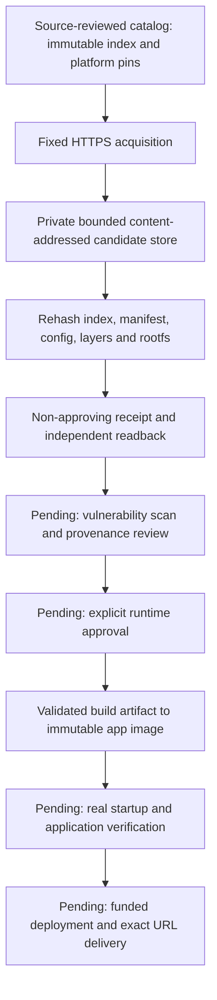

# Pinned runtime candidates — acquisition is not approval

Status: independently verified on the existing GCP host, 13 October 2026.
Two public OCI candidates exist in `/var/lib/gca-runtime-candidates-v1`.
No production runtime policy exists, no image was loaded into Docker and no
application was started by this acquisition. Vulnerability scanning, approval,
actual startup/security behavior and deployment proof remain open.

## Source and identity

Nginx is the static React-serving candidate; Temurin Java 17 is the Spring Boot
JAR candidate. [Nginx's release page](https://nginx.org/en/download.html) and
[Adoptium's container documentation](https://adoptium.net/installation/containers/)
identify the upstream distributions. Actual Docker Hub manifest bytes were fetched
and independently fingerprinted. Tags below were discovery hints only; acquisition
uses the immutable index and Linux/AMD64 manifest digests in trusted source.

| Role | Discovery hint | Linux/AMD64 manifest | Compressed layers |
| --- | --- | --- | --- |
| `nginx_static_v1` | `nginx:1.30.5-alpine` | `sha256:8f84ed99befc3891b8f329c5c202785278a2cfb7c25107d57fb2a134a3117433` | 26,073,522 bytes / 8 layers |
| `temurin_java17_v1` | `eclipse-temurin:17-jre-noble` | `sha256:af3852c35f8339ab7beba6f17b7fc15c4aca4d72979c5f09776c9ff74385058f` | 96,662,597 bytes / 5 layers |

Complete index/config pins are in `app/coding/runtime_base_acquisition.py`.
TLS registry retrieval and reviewed digest pins establish this acquisition's
source/content binding; they are not a vendor signature, vulnerability scan or
blanket guarantee of safety. The acquired bytes are public runtime bases, not
private Workspace data, repositories or user-created build outputs.

## Fixed operator path

`scripts.acquire_runtime_base_candidates` defaults to a read-only probe. `--acquire`
uses pinned IAP/SSH, verifies the exact GCP target, protected source/configuration
hashes, hosting STOP and available shared journal. The existing aggregate provides
one CPU, 3 GiB memory, no swap and bounded tasks; the complete acquisition has a
270-second alarm and requires 2 GiB existing disk headroom. There is no VM shape,
disk-size, paid model, service-account or deadline expansion.

The private candidate store contains source index, platform manifest, config,
compressed layers, a single-platform OCI index and a non-approving receipt.
Manifest/config/layer digests, byte counts, media types, platform and decompressed
rootfs diff IDs are checked. Layers are never extracted to the host filesystem.
HTTP endpoints are fixed HTTPS registry/auth/CDN hosts, proxy environment settings
are ignored and registry bearer headers are stripped on CDN redirects. Pull tokens
are scoped to the public repository and never persisted or printed.

Partial blobs are protected and bounded. A retry rehashes the prefix and appends
only after an exact HTTP 206 `Content-Range` continuation. A completed partial can
be reconciled by hash without network I/O. A changed digest, invalid range, public
inode, symlink, hard link or oversized response is not promoted. Fixed metadata
partials continue only if they are an exact prefix of the known intended bytes.
Existing completed content is rehashed and never silently overwritten.

The read-only probe rehashes actual retained content and rootfs, not just receipt
flags. This does not need Docker Desktop: its local CLI is currently unavailable,
and no alternative local runtime was substituted.

## Measured correction and retained history

The initial acquisition stopped before creating runtime blobs because the existing
parser rejected the official Nginx manifest's standard `annotations` property.
[OCI defines annotations as optional string metadata](https://github.com/opencontainers/image-spec/blob/main/manifest.md).
The correction accepts only bounded string maps: at most 64 entries, 256-character
keys, 2,048-character values and 32 KiB serialized metadata. Unknown executable
fields, external descriptor URLs, hooks and incorrect media/digests remain rejected.
Annotations never supply command, approval, deployment or model authority.

The prior failed plan SHA
`85985b5ae602b9452d9c9a4f5932b4f12ede71f3045d9870931f94c7dd2c6cd6`
was preserved. The completed acquisition's new plan SHA is
`d5f803f6864bc826805e720aa7131eeb2d25ef3a500697ad19ed0bd510c16ea6`;
its bounded source-handover history links the prior plan while preserving the
catalog, configuration and STOP. It does not rewrite the old failure as success.

Reviewed controller SHA:
`d657abde6f78ccd8ed2c2a84f32e87c85e14e74b6c20936a61b409816ea33649`.
Retained local Git blob: `5f751c07b014a06a325a5c0e3c091d3ab2da59fc`, under
`refs/gca/runtime-acquisitions/<controller-sha>`. The CLI supports that exact
reviewed controller for resuming/observing retained public data.

The corrected fourteen-file host closure was installed as
`48421865d76f8661f00fe8381c45bf713fb4f392702fbaa0eecafdceb9fa51ad`,
independently read-back snapshot
`b84b3c9da1c21220fb9027de4be1d8cee7c4c6b8811705c54230c61b3a2d08bd`.
Only OCI parser source changed. Policy/registry hashes and STOP were unchanged.
One verified obsolete predecessor copy (`65304859...`) was retired under fresh
source/retention hashes; current code, latest predecessor, journals and data remain.

Independent post-acquisition readback confirmed both candidate graphs/rootfs,
preserved plan lineage, no production runtime policy, Python image presence,
React/Spring enrollment, available journal and six running/healthy infrastructure
containers. Local verification: **1,617 coding tests passed without skips** in
67.67 seconds; 136 focused tests passed, plus coding lint, Bandit's medium/high
severity checks and whitespace validation. One pre-existing Google SDK deprecation
warning remains. Mock registry/CAS tests and live acquisition evidence are distinct.

## Acceptance still required

1. Scan exact bases and the separately pinned PostgreSQL runtime; retain scanner,
   database version, time, findings and remediation/exception decisions.
2. Review upstream provenance and grant explicit image-role approval before writing
   the protected runtime policy. A candidate receipt cannot grant that permission.
3. Prove trusted packaging/publication/signing using real source-bound build outputs.
4. Fund and authenticate deployment claims from current balance/cost evidence;
   preserve the protected Vertex and future-reserve allocations.
5. Verify generated React/Spring/PostgreSQL behavior, persistence, TLS and isolation,
   then deliver only the exact verified URL through authorized Chat.

The original full goal and other unchecked plan requirements remain active.

13 October scanner prerequisite: actual pinned Trivy release assets and the exact
signing workflow/issuer passed separate Sigstore verification and independent
binary readback. The Linux binary is retained locally as non-executable data.
No vulnerability database has been enrolled and no base scan or runtime approval
is claimed. See [scanner evidence and remaining gates](RUNTIME_SCANNER_PREPARATION.md).
