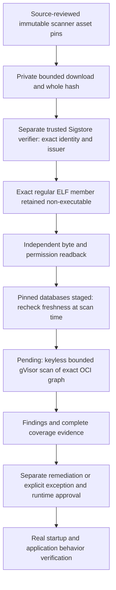

# Runtime scanner preparation: verified tool bytes, no scan claim

Checkpoint: 13 October 2026. The full project goal remains active. This closes
public scanner acquisition/signature preparation only; no executable runtime
approval, vulnerability-free claim, generated-app deployment or model call follows.
No GCP resource, hosting deadline, production dependency or protected budget changed.

## Why the scanner is also an input that must be verified

Trivy's maintainers documented compromised releases and CI actions in the
[March 2026 incident](https://github.com/aquasecurity/trivy/discussions/10425).
This project does not execute floating `latest` scanner binaries, install scripts,
or unreviewed workflow tags. The current
[v0.75.0 release](https://github.com/aquasecurity/trivy/releases/tag/v0.75.0)
was independently read from GitHub's public API with `immutable: true`.
Immutability and a valid signature establish a content/publisher binding, not a
guarantee that software has no vulnerabilities or malicious logic.

## Actual retained artifact evidence

Private local directory: `.gca-local/runtime-scanner-assets-v1`. It is ignored by
Git. Public release bytes, not user Workspace content, are stored there.

| Object | Size | SHA-256 |
| --- | ---: | --- |
| `trivy_0.75.0_Linux-64bit.tar.gz` | 51,704,231 | `c6e65abddb348e25f10549df887045629cf28cc72453cd1c63acb717316b3f3f` |
| Associated Sigstore bundle | 10,103 | `3565a49a9d857a977b18cb402323cb71ed806b735730c02a757c46133ddc12c0` |
| Bounded regular member `trivy.bin` | 172,765,344 | `93f9da8e4ba5e0c1c76d8234ed2494cf9afb0a96fd21953e424bb795f3299b8e` |

The actual signature verification used `sigstore-python 4.5.0`, the normal
production Sigstore trust path, and these **exact** certificate policy values:

```text
identity:
https://github.com/aquasecurity/trivy/.github/workflows/reusable-release.yaml@refs/tags/v0.75.0
issuer:
https://token.actions.githubusercontent.com
```

These match the upstream
[release-asset verification contract](https://trivy.dev/docs/latest/getting-started/signature-verification/).
The verifier checks certificate/signature/transparency evidence, not just whether
a JSON file has a `verified: true` field. No permissive identity regex, staging
instance or custom caller-supplied trust configuration is used. The scanner was
never invoked; only the separate trusted signature-verifier library ran.

Independent post-verification readback rehashed both public assets and the binary,
confirmed no executable permission, and retained receipt SHA-256
`712dc1f6a1d34e65d2c54390ba25da4942220e6bdbe9bf5ea8786b9927cfa112`.
Its fields truthfully retain `scanner_executed: false`, `scan_completed: false`
and `runtime_approved: false`.

## Implemented operator boundaries

`app/coding/runtime_scanner_assets.py` downloads only source-pinned release assets.
HTTPS endpoints are restricted to GitHub and its public release CDN; environment
proxies are ignored, and redirects discard authorization/cookies. Exact partial
range continuation and whole-file hashes reuse the existing private CAS helpers.
A stalled transfer retains a bounded partial, never a verified complete file.

Archive paths are not extracted to the host. The parser returns only the exact
regular `trivy` member, verifies Linux/AMD64 ELF metadata plus the binary's own
pin, and stores it as mode 0600. Traversal, links, duplicate binaries, unexpected
size/architecture/hash and executable retained data are rejected. Auxiliary
license/template files are inspected as bounded archive members, not executed.

The first signature attempt stopped at the interpreter protection check because
the ordinary venv symlink resolved through a group-writable Homebrew directory.
No shared directory permissions were changed: an exact-hash private interpreter
copy was installed in the operator venv. The next real signature check passed,
but extraction rejected the release's larger-than-assumed binary. Read-only
archive inspection established its exact size, which is now source-pinned; the
final verification and independent readback succeeded. These failures are not
misrepresented as scanner or runtime execution failures.

The verifier has an empty private HOME and an allowlisted environment, with no
application key/DSN/OAuth token supplied. It is an operator library process, not a
new sandbox that can be claimed incapable of accessing all host files. The Linux
scanner **must** run only later in the existing keyless gVisor boundary.

## Reproducible commands and dependency separation

`requirements-scanner-verifier-macos-arm64.lock` pins all 31 actual wheel versions
and hashes for the tested Python 3.14/macOS ARM64 operator environment. No entry
was added to production `requirements.txt`. The initial installation report is
retained privately with SHA-256
`9720cee971f061b0abe1c4504fb2b389219d810a6c6368c1acf85db592e9d4db`;
an independent comparison proved its distributions match the committed lock.
Future installs must use `--require-hashes --only-binary=:all:` in a separate
environment. Other platforms need separately reviewed native wheel hashes;
silently falling back to source builds or loosening hashes is not allowed.

```sh
# Content-only readback. It does not reassert a historical signature receipt.
.venv/bin/python -m scripts.prepare_runtime_scanner

# Bounded public acquisition; existing valid objects are rehashed, not redownloaded.
.venv/bin/python -m scripts.prepare_runtime_scanner --acquire

# Exact identity verification, no scanner execution.
.venv/bin/python -m scripts.prepare_runtime_scanner --verify-signature \
  --verifier-python .gca-local/scanner-verifier-v1/bin/python-operator
```



## Still required; these gates are not bypassed

1. Both public vulnerability and Java data artifacts were subsequently acquired
   and independently rehashed on the existing VM. See
   [actual database evidence](SCANNER_DATABASE_PREPARATION.md). Freshness must be
   rechecked at scan time; no database has yet been opened by the scanner.
2. Implement fixed scan arguments and execute the verified Linux binary inside
   keyless gVisor using the already-approved host resources/shared ownership.
   No Docker socket, credential mounts, untrusted shell, arbitrary network or
   concurrent unbounded scanning. Verify native limits and cleanup independently.
   The signature-bound binary was subsequently transferred as non-executable data
   to the existing VM; see [custody evidence](SCANNER_BINARY_CUSTODY.md). Custody
   closes a prerequisite, not the actual scan or its native execution proof.
3. Scan exact Nginx/Temurin and separately pinned PostgreSQL manifests, retaining
   the scanner/database/input/report hashes, duration, coverage and all findings.
   A successful exit, empty report or merely complete digest verification is not
   sufficient evidence of a successful vulnerability assessment.
4. Review remediation and time-bounded exceptions before runtime-policy approval.
   Scan metadata and model output never grant operator authority automatically.
5. Preserve the separate funded deployment, signing/publication, behavioral,
   persistence/TLS/tenant-isolation and exact Chat-URL acceptance requirements.

Focused acquisition/verification tests use synthetic archives and a mocked verifier;
they are distinct from the real public artifact/signature readback recorded above.
Verification: 54 focused scanner/acquisition tests and all 1,659 coding tests
passed without skips against loopback PostgreSQL (66.84 seconds). New-source
Flake8, medium/high Bandit checks and whitespace validation passed. One existing
Google SDK deprecation warning remains. The verifier and downloaded scanner did
not become application dependencies or a production release.
