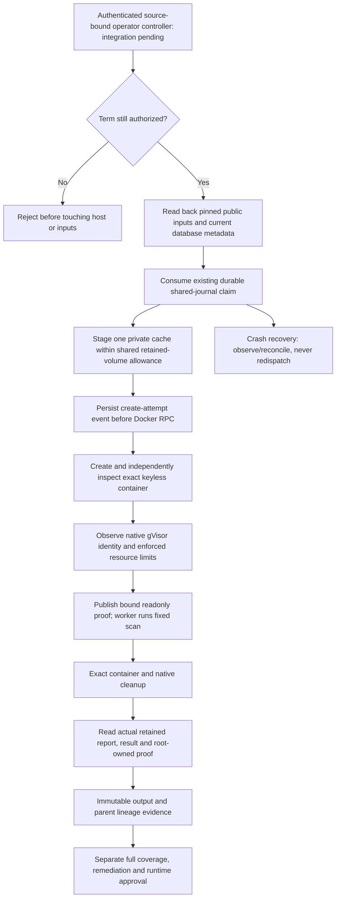

# Runtime scanner host launcher: local implementation, live proof pending

Checkpoint 22 October 2026. `app/coding/runtime_scan_host.py` implements the fixed
operator-side dispatch/recovery path for the existing two-stage keyless worker.
It is not a public/model tool, installed gateway, completed scan or runtime approval.
The target is now stopped and its approved term expired; see
[current hosting/billing evidence](HOSTING_TERM_STATUS_2026_10_22.md).

## Implemented boundaries

- Expired or invalid hosting authority is rejected before native admission, image
  lookup or multi-GiB source reads. The production STOP is unchanged.
- Public scanner, runtime graph and stage-specific database inputs use fixed roots,
  exact pins, actual readback and current freshness checks. No registry fetch or
  caller-selected shell/network command is part of scanner execution.
- Private staging uses the existing 2,040-MiB noexec volume and one writable database
  copy. Combined headroom is checked before allocation. Packaging and scan staging
  share one eight-directory retained-volume allowance, not separate doubled pools.
- The same SQLite/flock journal consumes one logical scan/role/stage dispatch.
  A write-ahead create-attempt event distinguishes preparation-only crashes from
  ambiguous container RPCs. Unknown creates retain uncertainty; neither expiry nor
  a reconnect grants a retry. Reconciliation never declares a scan successful.
- Container inspection checks exact identity/image, mounts, keyless user/environment,
  network none, read-only root, zero capabilities, gVisor, CPU/memory/tasks, private
  bounded executable tmpfs, descriptor ceiling, disabled Docker logging and no
  restart/healthcheck. Existing native PID/start-time/namespace/cgroup observation
  is reused, not replaced by guest `/proc` claims.
- Native readiness selects a fixed deadline field without adding an alias to the
  original frame; the native proof and guest hash bind the same complete request.
- Independent cleanup precedes actual report/result/proof readback. Private regular
  file ownership, links, bounds, hashes, expected package coverage and same-scan
  parent lineage are checked before immutable output metadata is published.
  Streamed responses must match retained output. Exact recovery can use the same
  completed job after a lost response without creating another container.
- `scan_completed` and `runtime_approved` remain false: actual full coverage,
  vulnerability remediation and governed approval are separate requirements.

## Test-clock correction after the approved term

The first 22 October focused run correctly rejected historical positive fixtures
whose dynamic `now + 180` crossed the fixed 19 October STOP. Fixtures now explicitly
simulate 13 October for successful historical scan/custody scenarios. Negative
tests independently advance past STOP and verify rejection before host/source
access. No production STOP, private data, key, grant or source pin was changed.

The existing-VM ledger integration tests likewise use an explicit historical
application clock and a `now()` function only inside each disposable unique test
schema, with an explicit search path. The PostgreSQL server clock and all non-test
schemas remain untouched. Transactions/concurrency run against real loopback
PostgreSQL; provider identity and historical time remain simulated, not live evidence.
Fresh credit alone cannot revive an expired VM obligation.

## Remaining integration and evidence

Still required: protected authenticated controller/source installation and readback;
explicit renewed hosting authority before any live work; fresh data/credential review;
actual two-stage native execution and output/cleanup proof; complete vendor/JRE
coverage; separate PostgreSQL runtime input; remediation or approved exceptions;
runtime-policy approval/publication and the funded generated-app/Google Chat proof.
The current local native-helper change is not present on the stopped VM. Do not
invoke the new launcher against old installed source and assume compatibility.

Unit/integration tests simulate Docker, mounts and native observations while using
real journal/filesystem bytes. They never run Trivy on the operator Mac and never
prove a live vulnerability assessment merely by passing.

Final 22 October worktree verification: **1,785 coding tests passed**, no skips,
against loopback PostgreSQL (69.79 seconds), with one warning. Targeted Flake8,
medium/high Bandit and whitespace validation passed. Unrelated user-owned provider/
architecture edits were preserved and are not part of this checkpoint's commit.
