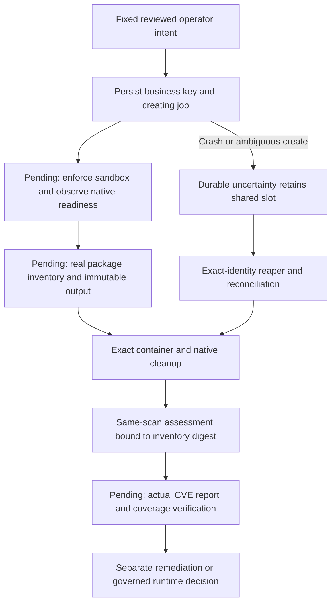

# Durable runtime-scan ownership — 13 October 2026

This checkpoint adds fixed operator dispatch and cleanup primitives to the existing
shared host journal, and installs/readbacks the reviewed source on the same VM.
It is not a completed vulnerability scan, approved runtime,
new production endpoint, model-selected shell profile or funded deployment.

## Why the lock is insufficient

The earlier scanner/database acquisition activities only moved public data, under
the existing exclusive journal lock. A real scanner will create a live sandbox.
Process death releases `flock` but does not prove that its container or native
gVisor helpers terminated. Such a scanner therefore needs a durable job row and
the same identity-safe reaper as validation/packaging, not a separate independent
lock that can admit another workload after a crash.

`Journal.begin_runtime_scan` reserves the existing slot as validation work, with
the exact fixed profile `runtime_inventory` or `runtime_assessment`. These are NOT
added to the ordinary public `PROFILES` command registry. Normal model-selected
validation dispatch cannot use them. The operator launcher must independently
verify source, target, inputs, database freshness, mounts, native limits and results.

## Closed binding and lineage

The closed version-1 binding contains:

```text
scan_id                     Canonical operator UUID for this logical scan
role                        Reviewed Nginx or Java-17 base role
stage                       inventory | assessment
image_id                    Exact previously enrolled Python toolchain
manifest_sha256             Exact reviewed public runtime platform manifest
scanner_sha256              Exact signature-bound scanner binary
signature_receipt_sha256    Hash of the earlier real signature-verification receipt
database_catalog_sha256     Exact reviewed vulnerability/Java catalog
inventory_sha256            null for inventory; exact parent digest for assessment
controller_sha256           Reviewed launcher's source fingerprint
stop_unix                   Existing fixed host STOP, never an extension
deadline                    Current stage deadline, at most 270 seconds
```

The business dispatch key is `SHA256([scan_id, role, stage])`, not a hash that changes
merely because a retry chooses another deadline. `runtime_scan_jobs` retains the
canonical complete binding, its independent fingerprint and the unique job ID.
Once that business key is consumed, changed deadlines/controllers cannot dispatch
it again. Observe/reconcile the existing job; a fresh scan requires separate explicit
operator intent. The history is capped at 32 entries, before another job is created.

Assessment additionally requires the same logical scan's inventory job to be cleaned
and a bounded retained output reference matching the exact inventory digest plus
native-proof fingerprint. The trusted output writer and independent actual-file
verification remain launcher responsibilities; synthetic metadata is not actual
package coverage. PostgreSQL is deliberately not silently approved as a third role:
its own immutable input still has to be reviewed and acquired.



## Cleanup is necessary, not task success

The ordinary shared reaper now requires actual native-process absence for both
scanner profiles as it already does for packaging. Container deletion alone does
not clear the slot. Unknown creation identity remains uncertain after expiry;
expiry is not authorization to retry or declare the work complete. A trusted
`create_not_attempted` observation is different from an ambiguous create response.

`observe_runtime_scan` rechecks retained binding/job identity, scoped containers
and native cleanup. A late container/helper revokes a previously clean observation.
Its result always leaves `scan_completed: null`: cleanup cannot prove an inventory,
successful assessment, vulnerability-free image or application correctness.

Tests cover crash persistence, shared-slot exclusion, fixed fields/pins/deadlines,
non-public profiles, replay tombstones, parent lineage, native cleanup failure,
unknown creates, late helpers, corrupted binding and history capacity. Test Docker
and native observations are mocked. Actual keyless scanner launch, coverage and
output verification remain unfinished.

## Actual host source checkpoint

The final tested source passed **1,719 coding regressions** without skips against
loopback PostgreSQL (69.06 seconds), 135 focused journal/packaging/custody/database
tests, lint/security and whitespace checks. One existing Google SDK deprecation
warning remains. The source file is 99,761 bytes, below the existing 100,000-byte
per-file contract; do not silently raise that limit for future monolithic growth.

A fresh full-bundle probe verified the old snapshot and idle journal. Source-copy
retention was full, so one explicitly audited obsolete seven-file predecessor
`d2f7f905459215b1462fbf414c0361b38af3e81a614c67e236898490ca4c319d`
was retired through the fixed controller. Active source, immediate rollback copy,
data and journal were preserved. Retention limits were not raised.

The actual fourteen-file apply passed isolated import and returned installation
`0f326470102669a63f364863f82c610225a006a70e567c5d40a0089bf26d399a`.
Independent read-only probing then confirmed:

- Complete installed source snapshot:
  `0d06e31b5b8b07faccdebc46bc0b508ad9aea3542a925de75f4597e755bb1a49`.
- `isolated_validation.py` SHA-256:
  `63308132f655b4a7c4ef7a0fb5104a876c87dec47151e67b5892c026c0ebb20a`.
- Immediate preserved predecessor snapshot:
  `b84b3c9da1c21220fb9027de4be1d8cee7c4c6b8811705c54230c61b3a2d08bd`.
- Retention snapshot:
  `7be2af7ab0cf1d26c81e1803d53488493a19f31e506d191301ce00b41e8b37d5`.
- Eight retention entries, no pending retirement or toolchain import, journal idle.

Policy/toolchain registry, resource limits, budgets, fixed STOP and infrastructure
were unchanged. No workload or scanner ran. Earlier public artifact custody keeps
its historical source provenance; current probes must use the new observed source
snapshot rather than rewriting old receipts or declaring a historical hash current.
