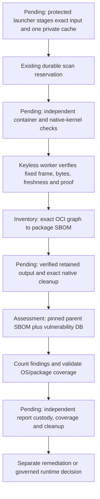

# Fixed keyless runtime-scan worker — 13 October 2026

This is local worker implementation, not a completed live scan or runtime approval.
The host-side implementation has subsequently been added locally; see
[host dispatch/recovery and remaining live gates](RUNTIME_SCAN_HOST.md). As of
22 October, the VM is stopped and the old hosting term has ended. Nothing in these
local implementations authorizes extending that term or reusing stale databases.
It advances the existing two-stage scan contract in
[the durable journal](RUNTIME_SCAN_JOURNAL.md). The current VM source snapshot remains
`0d06e31b5b8b07faccdebc46bc0b508ad9aea3542a925de75f4597e755bb1a49`:
the new worker has **not** been installed or executed there.

## Fixed execution contract

`app/coding/runtime_scan_worker.py` is a standalone Python-standard-library worker.
It imports no application configuration and receives no provider keys, OAuth tokens,
database credentials, Docker socket, shell command or model-selected arguments.
Only a trusted operator launcher may stage the closed request and native proof.
The proof's fields are checked inside the guest; its authenticity and actual kernel
observations must separately be established by the protected launcher.

| Mount | Purpose | Required boundary |
| --- | --- | --- |
| `/gca/input` | Request, native proof, signed-binary bytes, fixed config/empty ignore file, exact OCI graph or parent SBOM | Read-only, private UID 65532 files, no links |
| `/gca/cache` | One private copy of the stage-specific pinned database | Writable, private per-job noexec storage; never the shared immutable CAS |
| `/gca/output` | Report and bounded diagnostics | Private per-job noexec storage |
| `/tmp` | Exact hash-checked executable scanner copy | Private bounded sandbox tmpfs, exec/nosuid/nodev |

The cache is staged **once** by the launcher. Copying its multi-GiB database again
inside the guest would exceed the existing 2,040-MiB filesystem. The worker hashes
the actual private cache before and after execution; it does not silently accept
modified database bytes under the original content pin. Staging, scratch space,
report and filesystem overhead still require combined admission. This design does
not increase storage, CPU, memory, task limits or the fixed host STOP.

Inventory uses only the Java identification database and exact public OCI graph;
assessment uses only the vulnerability database and the same scan's retained SBOM.
The source pins both reviewed Nginx/Temurin manifests, signature-bound scanner bytes,
receipt, database catalog and Python toolchain. Inventory has no parent hash;
assessment requires an exact SHA-256 parent hash. PostgreSQL remains unapproved.

## Commands, bounds and evidence

Fixed Trivy v0.75.0 image/SBOM arguments disable downloads, telemetry, version/VEX
updates and progress output. They select OS and library packages, use the fixed
empty configuration/exclusion file, and never exclude unfixed findings or filter
severity. Inventory emits CycloneDX; assessment explicitly selects vulnerability
scanning, JSON and all packages. Flags differ where the pinned CLI differs.

The pinned upstream CLI references inspected during implementation were:

- [Image command](https://github.com/aquasecurity/trivy/blob/v0.75.0/docs/guide/references/configuration/cli/trivy_image.md),
  SHA-256 `5b69ac231bc6d25e6a7385d2d851e46fad8673ae5e84cc8c037a8193f6ba0d67`.
- [SBOM command](https://github.com/aquasecurity/trivy/blob/v0.75.0/docs/guide/references/configuration/cli/trivy_sbom.md),
  SHA-256 `3f6428aec0ca2015ae0059b032cb96227297978f4c799cdad1c1c62605e0a143`.

The subprocess receives an explicit empty-of-credentials environment, no stdin or
shell, one Go scheduler processor, bounded stdout/stderr and one monotonic deadline.
Overflow/timeouts retain only labeled partial diagnostics. The exact process group
is terminated even if descendants close their pipes. Host-native cleanup is still
separate. Guest file-descriptor limits stay at 64:64, matching the container's hard
limit; the unprivileged worker must not attempt to raise it.

Reports are bounded private regular files. Empty inventories, malformed package
identities, wrong generator/version, missing expected OS-package coverage and
unknown severity values are rejected. All finding severities are counted. Java's
vendor/JRE-binary coverage gap is explicitly reported for review, not assumed covered
merely because Ubuntu packages were scanned. Database freshness is a current-time
predicate, rechecked after execution; expired authority prevents result publication.

Worker output deliberately leaves `native_cleanup_verified`, `scan_completed` and
`runtime_approved` false. Its successful exit proves neither host cleanup nor full
vendor-package coverage. The launcher must validate actual output bytes and parent
lineage, retain findings durably, reconcile cleanup, and only then provide evidence
for a separate runtime decision. It must use the original closed binding when
calculating the native proof hash, not add a deadline alias and change its identity.

## Verification and remaining work

Final current-worktree verification: **1,755 coding tests passed**, with no skips,
against loopback PostgreSQL (67.92 seconds); the worker's 36 focused tests passed.
Targeted Flake8, medium/high Bandit, Python syntax and `git diff --check` passed.
One existing Google SDK deprecation warning remains. Unrelated user-owned provider
and architecture edits were preserved, not included in this checkpoint's commit.

Focused tests use synthetic scanner/database/OCI bytes and mocked native envelopes.
Toy Python subprocesses test output, timeout and credential stripping; **Trivy is
not invoked on the Mac**. Neither these tests nor the existing signed-artifact
custody proves that the real two-stage Linux scan has run.

Still required: fixed host launch/staging and combined resource admission; protected
source installation/readback; actual keyless native execution of both stages;
retained output/cleanup reconciliation; full package/vendor coverage review;
PostgreSQL input; remediation or approved exceptions; runtime-policy publication;
funded generated-app deployment and exact Google Chat URL delivery. Core Railway
recovery and private model eligibility remain separate blockers, not bypasses.
