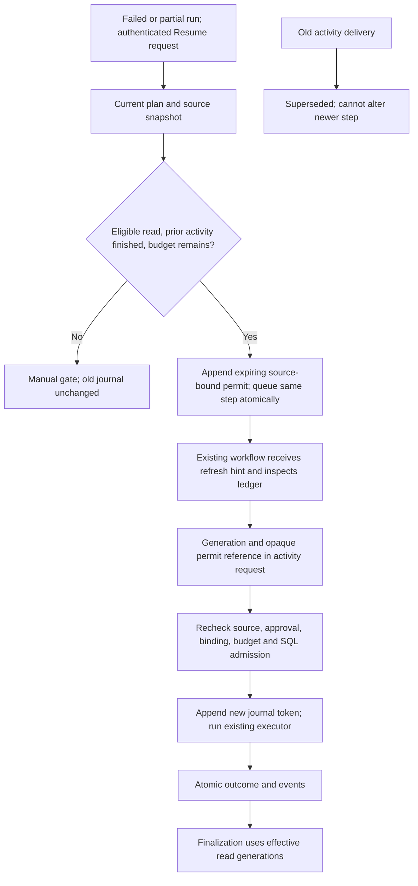

# Temporal read retry generations

26 October 2026. Migration 032; local implementation, not live activation.

A repeated delivery of the **same** activity is not a new request to execute it.
Retrying an eligible failed read now uses a new, explicitly authorized generation
while preserving the old journal row and its uncertainty. Writes remain excluded.

## Authority and eligibility

The existing authenticated resume transaction holds run/step locks and invokes the
deterministic reconciler. New permission requires:

- The current step and typed plan agree on service, operation, read-only status,
  dependencies, risk, approval, arguments and pre/postconditions.
- Allowed tools belong to the explicit trusted read inventory, or the operation
  is a supported tool-free information/composition operation. This is not inferred
  from a tool name prefix or an LLM's claim.
- The prior journal was admitted under `read-safe-v1`, is not executing and has a
  completed boundary. Earlier journal rows must also be read-only and quiescent.
- No private receipt, legacy attempt or saved execution indicates a write.
- The source snapshot still matches and is at most five minutes old. Actor and
  tenant must match. Required approval must still be current, unless the stored
  scoped waiver applies. Authentication, permission, policy and planning failures
  remain review gates.
- The persisted attempt budget remains. Its counter is not reset by Resume.

`READ_TOOLS` and `WRITE_TOOLS` explicitly partition today's registered tools. The
shared invocation gate now rejects a write **or unclassified tool** in a read-only
durable step before receipt reservation or provider invocation. This enforcement
applies to PostgreSQL and Temporal calls. Existing non-durable rollback behavior
is unchanged. New activity rows record the enforcement policy; legacy rows are
not retroactively assumed safe.

The permit and authorization event are appended in the same resume transaction
as the queued state. It is not a model-generated success flag, an API-provided
token, a fresh workflow, or a transfer back to PostgreSQL execution.

## Identity, lifetime and bounds

The journal key expands to `(run_id, step_id, generation)`. Generation zero retains
its previous activity ID. New generations use distinct activity IDs containing
step/generation/opaque permit reference; the actual execution nonce stays in SQL
and trusted activity context. History still receives references, not user content.

Each permit binds the exact prior token, source digest, actor mapping and next
execution nonce. An independent SQL insertion trigger checks the binding, current
source, tenant, read-only state, remaining budget, prior quiescence and workflow
lineage before a new generation is admitted. Parent erasure clears private links;
identity and authorization metadata cannot be rewritten. Downgrade refuses retained
permits or nonzero generations rather than silently collapsing history.

Permits expire within 15 minutes. A stale source or expired permit cannot execute
tools. Explicit Resume can append a replacement permit for the same not-yet-started
generation; it never edits the older permit. Lifetime history is capped at eight
permits per step. Generation is capped at three retries, with total attempts also
bounded by `min(stored max_attempts, 4)`. Normal planner reads currently have three
total attempts, not three additional attempts. These are maximums, not guarantees
of available model quota or provider success.

Approval expiry is checked again before invocation, not only when issuing a
permit. Superseded references cannot fail a pending/current replacement step.
Current journal lookup, completion writes, callbacks and result lookup use the
appropriate generation/token rather than an arbitrary matching history row.

## Effective state without erasing uncertainty

An old uncertain read remains uncertain in history. Once its specifically
authorized successor is admitted, it is no longer treated as an unresolved
**write** hazard that prevents the successor's verified read result from completing.
This only applies to proven read-only generations; it never excuses an uncertain
write. The latest attempt and all required steps must still complete truthfully.
An older read proof cannot satisfy a newer generation's resolution check.

A finally callback may record the old activity's completed boundary without
changing its uncertain outcome. This proves that activity code finished, not that
a remote write was revoked or rolled back. In-flight remote reads can outlive a
connection; the per-call read policy prevents them authorizing a later write.

## Local verification

`tests/coding/test_temporal_read_retry.py` drives the actual authenticated resume
handler, SDK `ActivityEnvironment`, journal SQL, existing executor and finalizer.
It tests a synthetic Gmail failure/retry through the real shared tool wrapper,
with no Google/model call; old-delivery races against a running newer generation;
unchanged old uncertainty; source/approval/permit expiry; renewal; retry and permit
caps; legacy provenance/write evidence; malformed references; direct SQL nonce
forgery; private erasure and downgrade guards. Tool-admission tests separately prove
that read steps cannot invoke write/unclassified tools. Registry inventory tests
prevent an unclassified new tool from silently becoming a read.

SDK doubles and loopback SQL do not establish server history replay, task-queue
rollout, broker delivery, production capacity or live Google correctness. Those
requirements remain open.

Final local verification: **2,285 coding/unit tests passed without skips** in
64.18 seconds, including 19 focused generation cases and the read-only tool-policy
guards. All 44 golden planner cases and 16 no-network workflow fixtures passed.
The complete disposable upgrade-to-032 → downgrade-to-002 → upgrade-to-032 chain
and empty-data retention integration passed. Targeted lint, medium-confidence
security and whitespace checks passed. Thirteen pre-existing SDK/fork warnings
remain; these are not live server or production load results.

## Rollout and remaining work

Apply schema 032 before using these new Workspace activities. Quiesce older
activity workers and use the reviewed version-pinned worker; mixed arbitrary old
code is not claimed to support multi-generation history. Keep initial intake,
transport and refresh publisher activation behind their existing independent
gates. Replay actual histories and verify versioning before any production rollout.
Generation-zero IDs/default history fields are preserved, not a proof of universal
cross-version replay compatibility. No live Temporal service is running here.

Writes, partially completed composite mutations, compensation and unknown-write
lookup still need their own evidence and policies. This checkpoint does not turn
`manual_required` writes into automatic retries, reset completed artifacts, start
a VM, spend protected funds or complete the original upgrade goal.

See [write-ahead tool receipts](DURABLE_TOOL_RECEIPTS.md),
[verified write recovery](TEMPORAL_VERIFIED_RECOVERY.md),
[live invocation gates](LIVE_TOOL_ADMISSION.md) and
[original ownership constraints](WORKFLOW_OWNERSHIP.md).

Subsequent real-server checkpoint: read-generation Resume and actual refresh were
also exercised after worker restart and clean SQLite server restart, followed by
fresh-process history replay. This strengthens the local evidence above but does
not establish production model/write, abrupt crash, HA or cross-version rollout
correctness. See [measured server scope](LOCAL_TEMPORAL_SERVER_PROOF.md).

Subsequent schema-034 checkpoint adds a **separate**
[verified-prefix write-generation mechanism](TEMPORAL_WRITE_PREFIX_GENERATIONS.md).
The original read SQL guard is retained as `admit_temporal_read_generation_v032`;
SQL constraints/triggers reject substitution between permit types. This does not
relax read-only tool classification or authorize blind unknown-write retries.
