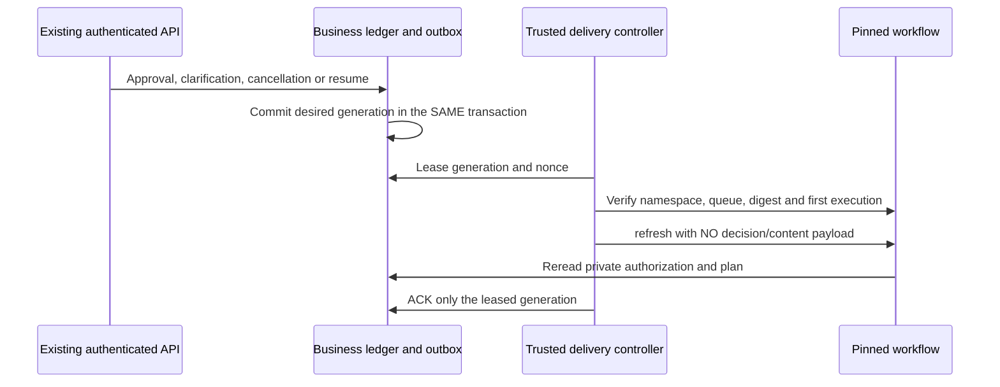

# Transactional Workspace refresh hints

25 October 2026, local checkpoint. Schema **029** connects actual business changes
to coalescing refresh delivery. Notification capture is independently **off by
default**, requires review evidence and uses the existing dispatch-policy audit.
No live server, publisher, signal or production migration has been started.

Relevant status, plan, clarification-answer and erasure changes generate hints only
for Temporal Workspace runs. Heartbeats and PostgreSQL runs do not. Capture has no
historical backfill. Each run has desired/acknowledged/in-flight generations; an ACK
for generation 7 cannot consume a newer generation 8. Scope cannot be rebound and
generations cannot decrease. Pending hints cannot be silently deleted. A serialized
2,000-undelivered-run ceiling applies backpressure: capture failure rolls back the
business change too. Hard erasure still deletes private data and nulls its parent
link, retaining only the reconciliation reference. Ordinary deletions are preserved.

Claims require an acknowledged startup receipt, bounded database waits, a 60-second
nonce lease and at most ten attempts per generation. New source changes survive
an older attempt; stale ACKs cannot consume current work. SQL ACK/failure writes
have five-second total waits, transport has a 30-second bound and SDK calls have
ten-second deadlines. Lost responses repeat only a hint, never a tool/approval.

The optional SDK adapter pins first execution, validates namespace, workflow ID,
type, task queue and contract/digest memo, then calls only `signal('refresh')` with
no payload. It cannot start, replace or terminate workflows. Closed/foreign
executions are blocked for reconciliation. A delivery ACK is not business success.
The workflow must always reread the authenticated private ledger before executing.

Eleven focused tests cover actual `decide_run` capture, SQL rollback, private
clarification changes, coalescing, concurrent claims, stale nonces, lost responses,
erasure, evidence gates, downgrade refusal and SDK-bound signal arguments. Combined
Temporal modules pass 54 targeted tests. Full disposable upgrade-to-029/downgrade-
to-002/upgrade-to-029 and empty-data retention passed, alongside targeted lint,
security and whitespace checks. SDK service doubles are not live server proof.
The preceding full coding suite passed 1,918 tests **before this diff**; a new full
suite is not claimed while Mac disk is low.

Operator publisher deployment, live signal/history proof, admission UX, alerts,
retention, safe retry/reconciliation generations, coding workflows, compensation,
replay and live rollout remain open. Notifications must be deployed/enabled before
Temporal intake; otherwise waiting relies on bounded timeout polling. See
[Workspace bridge](WORKSPACE_TEMPORAL_EXECUTION.md) and [ownership](WORKFLOW_OWNERSHIP.md).
