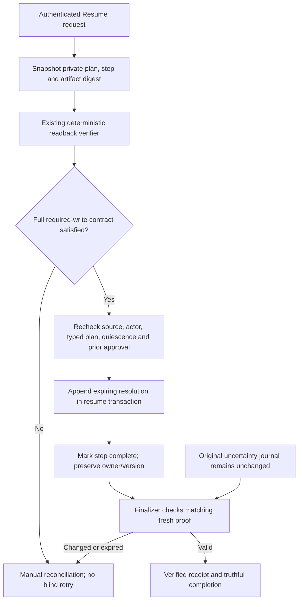

# Verified recovery without erasing uncertainty

25 October 2026, local schema **030** checkpoint. The existing authenticated resume
helper can now resolve verified completion without issuing another Workspace write.
Admission, publishers and live Temporal workers remain off.

The source digest covers current plan/authority, executor, step arguments/output,
dependencies, policy fields and artifact verification/cleanup/sharing metadata.
Readback happens outside database locks. The commit transaction rechecks the tenant
run and step in execution lock order. It rejects changed/deleted source or a step
that no longer matches the current typed plan. Every required write must be present
and successful, in order when required: a created-but-unpopulated Sheet is not a
completed create-and-populate request. This correction also applies to PostgreSQL.

The journal must be quiescent, with a completed boundary—not merely an expired
lease. Explicitly unauthorized writes remain manual. A step requiring approval
needs a matching approved plan decision **before** its journal started; later
approval/current bypass cannot retroactively authorize it. No client or LLM success
Boolean supplies this evidence. The resolution writer is trusted internal code.

Observations older than five minutes or from the future fail. Proof expires within
fifteen minutes of observation start. Fresh readback appends renewal rather than
mutating history. The new table stores hashes, IDs, timestamps and an opaque actor
reference, not bodies, recipients, OAuth secrets or raw verifier evidence. Erasure
nulls the actor mapping and missing parents invalidate proof. Privileged database
administrators can change schema; generated code must stay keyless.

Verified bounded receipts replace stale error prose. This private output update,
its resulting source digest and resume commit are atomic. Later source/artifact
changes invalidate proof. Original uncertain journal state is never overwritten.
Temporal/canary versions stay pinned; ordinary PostgreSQL control keeps its old
repinning behavior. Queuing one recovered step does not blindly restore the whole
run's side-effect integrity to 100.

An existing Temporal journal with a `safe_to_retry` decision instead returns
`temporal_retry_generation_required`: safe retry generations, lost-worker quiescence
and compensation remain open. A step with no journal retains the first-attempt
path. Downgrade refuses retained proof; that does not prove external history drain.

**Evidence:** 82 targeted Temporal/recovery/verifier tests passed, including the
actual resume helper, deterministic Sheet readback via local doubles, a concurrent
source race during readback, proof renewal, actor/plan/freshness checks, quiescence,
non-retroactive approval, erasure, receipts and old PostgreSQL behavior. Full
disposable upgrade-to-030/downgrade-to-002/upgrade-to-030 and empty-data retention
passed. Targeted lint/security/whitespace passed. These are not live Google writes
or Temporal server/replay proofs. The older full 1,918-test result predates this
diff; no new full result is claimed while Mac disk is low.

No provider/model call, production migration, activation, VM restart or funding
change occurred. Retry generations, compensation, coding workflows, publisher
placement, live replay and the remaining original upgrade gates stay open.
