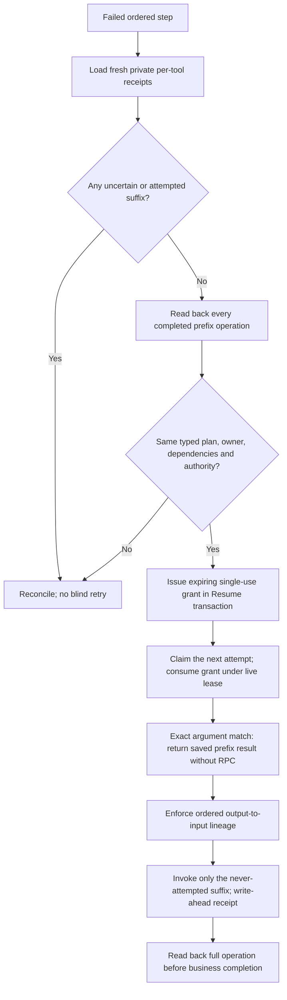

# Verified-prefix recovery of ordered Workspace writes

Local implementation checkpoint, 26 October 2026. Schema **033** extends the
existing authenticated Resume handler and actual PostgreSQL step executor. It is
not a deployment, a Temporal write generation or remote exactly-once delivery.

## What now executes

The ordered contracts currently include Sheet creation → population and Chat
destination resolution → sending. If the first operation returned, its encrypted
receipt survived, and the second operation **never crossed invocation admission**,
Resume can verify and reuse the prefix rather than create the resource again.
This uses the shared ordered contract, not phrases matching one user's request.

## Authority and invariants

- The reconciler requires fresh, decryptable, tenant-bound receipts with an exact
  successful prefix. Legacy partial logs do not suffice. Unaccounted historical
  writes, failed/unknown suffix receipts and unavailable write evidence block it.
- Deterministic provider readback must succeed. Its observation is at most five
  minutes old when the grant is issued; the final Resume transaction rechecks the
  receipt snapshot, locks the run/step and commits the grant, queue transition and
  reconciliation event together. An event-sink failure rolls all three back.
  Verified prefix artifacts are retained/displayable even though the whole step
  remains pending. Merely returned artifacts from a failed step stay unverified
  and do not acquire automatic safe-delete authority.
- The grant binds the typed plan, request, step contract, dependency outputs,
  approval bypass state, cohort and executor version. Current approval is required
  unless the stored run has an explicit bypass. A different executor is not
  silently authorized to reuse the old plan or resource.
- Grants contain hashes/opaque identities, not a second copy of private content.
  They expire within 15 minutes, are consumed once by a hashed live lease owner,
  and allow at most three explicit continuations per step lifetime. Attempt counts
  increase; automatic retry limits are not reset or expanded.
- Every prefix reuse checks the live ledger again, exact canonical arguments,
  unchanged encrypted evidence and grant expiry. Concurrent prefix admissions are
  rejected. Downstream resource IDs must match verified upstream lineage.
- Reuse produces `verified_tool_result_reused`, explicitly `provider_called:false`.
  It does not create a fictional provider attempt, receipt, latency or token usage.
  A fresh suffix call uses the normal write-ahead receipt and verification path.
- Wrong tools, changed arguments/recipient/content/dependencies, cancellation,
  tenant erasure, lost leases, changed approval or expired grants fail closed.
  A suffix failure cannot be retried within the same scope. Completion requires
  consuming the entire ordered contract and the existing full readback verifier.

## Storage and rollout

`tool_prefix_continuations` references the exact run/step and cascades on hard
erasure. It stores only bounded recovery metadata. Public/reporting roles have no
table access. Binding/expiry fields are immutable; consumption is one-way.
Downgrade refuses retained grants. Apply schema 033 before using this recovery
path. Pre-033 reconciliations stay manual, and already completed writes/read-only
steps retain their existing behavior. No production migration has been applied.

## Proof and limits

`tests/coding/test_prefix_continuation.py` exercises actual SQL, authenticated
Resume, the public step wrapper, shared invocation boundary, existing typed Sheet
and Chat helpers and deterministic provider-readback logic. Synthetic provider
counters prove reuse of the original resource and exactly one new population or
message invocation in these tests. Other cases cover source/evidence/approval
changes, exact argument/lineage rejection, cancellation, concurrent admissions,
single use, bounded continuations, transaction rollback, erasure and downgrade.
These are not real Google effects, an arbitrary coding sandbox or live deployment.

Final local evidence for this checkpoint: **2,321 coding/unit tests passed** without
skips in 94.87 seconds, including 27 new prefix/artifact cases. Thirteen existing
Google SDK and multithreaded-fork warnings remain. All 44 golden plans and 16
no-network workflow replay fixtures passed. Full disposable upgrade-to-033 /
downgrade-to-002 / upgrade-to-033 and empty-data retention passed, as did targeted
lint, medium-confidence/medium-severity security and whitespace checks.

The existing five actual loopback Temporal server cases also passed against the
new migration head in 6.53 seconds, followed by fresh-process offline replay of
all five histories. Synthetic artifacts are ignored under
`.gca-local/temporal-proof/20261026T121216Z-52ca45b1/`. This proves no regression in
those existing read/info/cancel/erase/restart paths, **not** Temporal write-prefix
continuation. No production migration, cloud restart, provider/model call or new
paid allocation occurred.

This checkpoint intentionally does not authorize a new Temporal write generation:
that requires its own source-bound journal/permit, activity identity and replay
proof, rather than bypassing the existing read-only generation rules. It also
does not retry a provider write with unknown acceptance, an attempted failed
suffix, appends, arbitrary graph rewrites or changed executor versions. Those
remain separate recovery work, not silently completed requirements.

Provider state may change after readback; no local grant can lock a remote Google
resource. Missing/deleted/changed resources must fail readback or the suffix and
remain incomplete, never trigger an unapproved replacement creation. The
underlying service-specific verifier's scope still matters; this grant does not
add ownership/sharing/content guarantees that a verifier does not check.

See [private receipts](DURABLE_TOOL_RECEIPTS.md),
[live invocation admission](LIVE_TOOL_ADMISSION.md),
[Temporal read generations](TEMPORAL_READ_RETRY_GENERATIONS.md) and
[local server proof](LOCAL_TEMPORAL_SERVER_PROOF.md).
