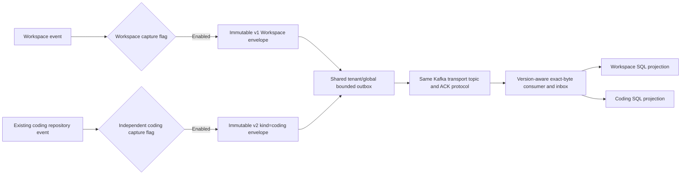

# Coding and Workspace events in one delivery plane

Local checkpoint, 22 October 2026. Migration **025** extends the shared
[outbox](WORKFLOW_EVENT_OUTBOX.md) and [SQL consumer](WORKFLOW_CONSUMER.md) to existing
`coding_run_events`. Both capture flags remain **off by default**. No production
migration, broker, model call, service start, VM restart or funding change occurred.
This is event visibility/delivery, not a second coding or Workspace executor.

The arrows describe local code, not live broker observations. Independent source
BIGSERIAL IDs routinely overlap; run UUIDs are also scoped to their business tables.
Source lookup and ordering therefore use kind plus identity, not bare IDs.

| Concern | Workspace | Coding |
| --- | --- | --- |
| Capture flag | `capture_enabled` | `capture_coding_enabled` |
| Default | Off | Off |
| Wire schema | Existing `gca.workflow.event.v1` | `gca.workflow.event.v2` |
| Workflow kind | Implicit `workspace` in v1 | Required `coding` in v2 |
| Partition key | `tenant_uuid:run_uuid`, unchanged | `tenant_uuid:coding:run_uuid` |
| Business parent | `agent_runs` | `coding_runs` |
| Derived view | `workflow_run_event_projection` | `workflow_coding_event_projection` |

The decoder accepts both versions, rejects a kind field in historical v1 and a
missing/unknown kind in v2. Existing Workspace bytes, hashes, keys and leases survive
the expansion. The shared `gca.workflow.events.v1` topic name identifies this
transport generation, not a promise that every envelope has one wire schema.
Capture flags are independent and audited; no historical backfill or automatic
activation occurs. The Workspace publisher retains its older-schema staging path.

## Implemented integrity

Migration 025 adds the coding sequence counter, composite source identity
`(workflow_kind, source_event_id)` and order `(workflow_kind, run_id, sequence_no)`.
Generated parent columns select exactly the matching real business table and retain
cascading foreign keys. This is not an application/model-only parent assertion.
Coding capture is an `AFTER INSERT` trigger on the **existing** repository event
table; tests call `append_coding_event`, not a disconnected alternate event helper.

Capture validates tenant/privacy state, reserves common pending capacity and commits
or rolls back with the business event. The two kinds share the 50,000 global and
2,000 per-tenant pending ceilings; neither receives an extra allowance. No message,
payload, code, repository body or secret enters Kafka. Claims compare kind as well
as run ID, so equal UUIDs do not collide or create false head-of-line dependencies.

The consumer checks the correct live parent and current owner against the private
tenant mapping, verifies exact bytes and writes only the matching SQL projection.
It requires a returned projection row before reporting application success. Inbox
and projection commit together; neither can approve or execute business operations.
Hard/soft erasure filters the workflow kind, and final tenant cleanup considers
both business ledgers. Erasing one equal-UUID run cannot erase the other kind.

## Rollout, rollback and evidence

1. Review/apply database expansion with backup and business-ledger rollback controls.
2. Roll out version-aware consumers **before** enabling coding capture. Old v1-only
   consumers stop on v2; do not claim seamless live rollback or skip such records.
3. Prove actual mixed-source delivery, isolation, capacity, lag and failure recovery
   on approved infrastructure before individually enabling the capture flags.
4. Before downgrade, disable capture and reconcile consumer offsets for all v2
   records. Stop publication/consumption and export diagnostic evidence. Database
   delivery rows alone cannot prove that broker offsets have drained.

Migration 025 refuses downgrade while coding capture is enabled or any coding
delivery is unpublished. Once reconciled, it removes acknowledged **derived coding
delivery** metadata, restores historical Workspace constraints and preserves all
original coding/Workspace business events. It cannot recall v2 Kafka bytes or prove
consumer drain. Separate 024/023 rollback requirements still apply.

Disposable PostgreSQL tests create deliberately equal source IDs and run UUIDs.
They prove independent keys/views/flags, no backfill, capacity rollback, actual
repository capture, concurrent ordering, privacy erasure in both directions,
changed-owner rejection, preservation of old Workspace bytes/leases and downgrade
refusal/drain. Kafka adapter tests exercise both schemas with fake ACKs. The full
migration chain upgrades to 025, downgrades to 002 and upgrades back with retention.

These are local SQL and mocked transport proofs. Live broker/ACL/failure-domain/
multi-member/load evidence, active lag dashboards/alerts, Temporal single-owner
orchestration, approved hosting renewal and the full original goal remain open.
