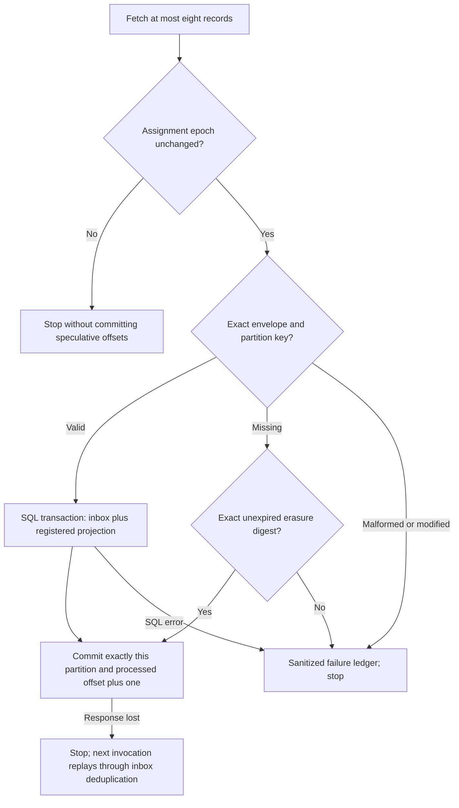

# Bounded Kafka consumer and SQL projection

Local checkpoint, 22 October 2026. Migration **024** extends the default-off
[outbox](WORKFLOW_EVENT_OUTBOX.md). No migration, service, capture switch, Kafka
broker or cloud resource has been activated. This remains partial Sprint 62 work,
not complete orchestration, production availability or live broker proof.

## Implemented path



- [Consumer transport](../app/runs/kafka_consumer.py) uses a fixed group,
  `gca-workflow-projection-v1`, and topic, `gca.workflow.events.v1`.
- [Registered SQL projection](../app/runs/workflow_projection.py) is the only
  handler. No model-selected Python function, shell, provider or external write runs.
- [Migration 024](../migrations/versions/024_workflow_consumer_projection.py) stores
  derived projection state, privacy-digest tombstones and sanitized failures.
- [Operator CLI](../scripts/consume_workflow_events.py) is explicitly invoked,
  bounded and not part of any existing service startup.

## Offsets and initialization

Auto-commit is disabled. `apply` returns only after the database transaction
commits. The consumer then commits `{that_partition: processed_offset + 1}`, not
the whole fetched batch. A duplicate inbox entry is a safe redelivery; only its
transport offset needs acknowledgement. A lost Kafka commit response is uncertain,
not a reason to repeat business or external writes.

The default `auto_offset_reset='none'` refuses an absent/invalid starting position.
A new group without committed offsets reports `offset_bootstrap_required`. The
operator may explicitly initialize **missing** group positions to the retained
beginning with `--initialize-new-group`. It never resets existing committed offsets
or silently skips a retention gap. Topic retention bounds what can be replayed;
there is no backfill of events captured before the default-off bridge was enabled.

Invocation shape after separate rollout approval:

```text
python -m scripts.consume_workflow_events --max-batches 1
# Add --initialize-new-group only for an explicitly reviewed first initialization.
```

This uses the same explicit environment variable names as the publisher, but each
process needs separately scoped credentials: read/describe on the fixed topic,
read on the fixed consumer group, and least-privilege projection/inbox SQL access.
No source, Google OAuth or deployment credentials are needed. Remote connections
use verified TLS; no `.env` file is automatically loaded. Dependency pins remain
in `requirements-orchestration.txt`; there is no implicit core-provider change.

## Rebalance, cancellation and shutdown

Assignment callbacks maintain local epoch tokens. Revocation removes ownership
and cancels a matching active SQL task without taking application locks or awaiting
fetch/commit inside the callback. Before offset commit, the task checks the same
ownership epoch again. Kafka's group generation still provides the distributed
commit fence; local state alone cannot prove broker ownership.

A batch crossing a rebalance stops the invocation. It is not discarded followed
by continuing at an already advanced fetch position, which could skip unprocessed
records. If the SQL transaction was interrupted it rolls back; if SQL had already
committed, redelivery is deduplicated. No speculative batch offsets are flushed in
the revocation callback. This favors a safe replay over claiming zero duplicates.

Each SQL application and Kafka offset commit has a five-second deadline. The
consumer fetches at most eight records, has bounded byte/fetch/poll settings and a
300-second invocation lifetime. Startup/SDK cleanup are bounded. SIGTERM finishes
the current record, then leaves remaining fetched records uncommitted; parent task
cancellation is not converted to success. `batch_finished` is not a claim of zero
lag or complete consumption across all partitions.

## Privacy deletion and poison records

Run erasure deletes authoritative envelopes and cascades projections/inbox entries.
Before envelope deletion, a trigger records only its SHA-256 digest and a 48-hour
expiry. It stores no event/run/user IDs or raw content. A matching old broker record
can advance its offset as `erased` without recreating data. A changed body, wrong
partition key, unknown envelope or expired tombstone cannot claim that disposition.
Digests remain linkable to anyone possessing broker bytes; they are not anonymous.

Tombstones do not erase Kafka bytes. The topic profile requires 24-hour retention
and one-hour segment rolls, but deletion is asynchronous, not a precise clock or
instant hard storage limit. If a broker retains an old record beyond the digest
window, consumption stops for review rather than accepting an unverifiable record.
No global safe-skip permission is inferred from privacy erasure.

Malformed input, an unknown source or a failed projection produces one bounded
attempt and then stops without offset advancement. The failure ledger records
only fixed topic, partition, offset, a digest when within the message-size bound,
closed category and timestamps. It stores no body or exception message. There are
at most 10,000 distinct record locations; the diagnostic attempt counter saturates
at three. That counter does **not** authorize three automatic retries or a skip.
Repair the exact source/SQL/transport problem and explicitly restart. No implicit
scheduler or model loop has been introduced.

Retention removes at most 500 expired tombstones and 500 failure records per pass;
failure diagnostics expire after seven days. Expiry does not commit offsets or
authorize replay. Tombstone generation still requires measured storage planning:
TTL and bounded cleanup batches are not a hard cap on their total row count.

## Derived projection is not execution evidence

`workflow_run_event_projection` records the highest observed sequence, last
event type/phase and distinct observed-event count under its tenant UUID. It cannot
set run completion, approve actions, choose an executor or verify a Google write.
Its count is not an all-time business count: capture start, retention and erasure
bound what it can observe. Original PostgreSQL business records remain authoritative.

## Evidence and remaining work

The real pinned `aiokafka==0.14.0` constructor and listener subscription accepted
the exact options offline; `start` was not called and no broker connection opened.
Tests use real disposable PostgreSQL schemas and fake transport to prove:

- Atomic inbox/projection commit and duplicate suppression under concurrency.
- Highest-sequence visibility under out-of-order delivery, without false completion.
- Real in-flight PostgreSQL cancellation/rollback during a simulated rebalance.
- SQL commit before Kafka commit, and safe replay after a lost commit response.
- Erasure, exact-digest matching, wrong-key/modified-body rejection and TTL behavior.
- Explicit group bootstrap, exact offset commits, poison/oversized-batch stops,
  cancellation and SDK cleanup across start/stop/policy failures.

The [official manual-commit guidance](https://aiokafka.readthedocs.io/en/stable/examples/manual_commit.html)
and [consumer/rebalance documentation](https://aiokafka.readthedocs.io/en/stable/consumer.html)
inform this boundary. They do not establish this deployment's live behavior.

Still required: approved broker placement/cost, topic/cluster identity and ACL
review, real multi-member/rebalance/network/retention/load tests, lag dashboards
and alerts, coding-event capture and Temporal single workflow ownership. All
external Google/deployment execution remains outside this consumer. No extra paid
service may be placed on the stopped VM without new authority/capacity approval.

Before downgrading 024, stop the consumer and export/reconcile failure evidence.
The migration drops derived projections, diagnostic rows and tombstones, not
business events. The separate 023 downgrade still refuses outstanding unpublished
delivery intent. Do not erase such intent just to pass the downgrade gate.
