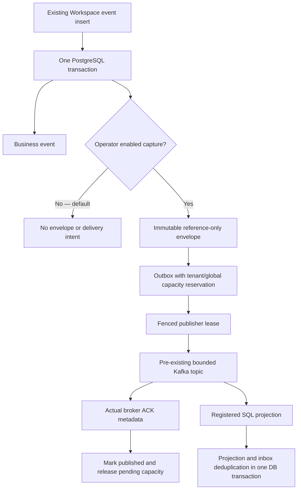

# Workflow event delivery — local implementation checkpoint

Status: 22 October 2026. Migrations **023–025**, a bounded optional Kafka publisher
and a registered SQL consumer are implemented locally. **Capture is disabled by default.** No production
migration, broker, cloud resource, service, credential or paid dependency has been
created or activated. This is partial Sprint 62 progress, not complete durable
orchestration or live delivery proof.

## Implemented boundary



The diagram's Kafka connection is an implemented adapter, **not an observation of
a running broker**. The subsequent local consumer checkpoint implements a bounded
process, assignment/rebalance handling and manual offset commits, not live broker
proof. See [the consumer lifecycle](WORKFLOW_CONSUMER.md) for exact boundaries.

An `AFTER INSERT` trigger on `agent_run_events` captures all existing SQL insertion
paths without requiring each caller to remember a separate publish call. Capture
and business writes commit or roll back together. It does not execute tools or
become a second workflow owner. The bridge now also covers `coding_run_events`
through a separate default-off flag and explicit v2 identity; see
[coding event integration](WORKFLOW_CODING_EVENTS.md). Temporal ownership/events
remain unfinished. There is no historical backfill.

Implementation:

- [Migration 023](../migrations/versions/023_workflow_event_outbox.py): contract,
  immutable storage, capture, counters and privacy triggers.
- [Delivery primitives](../app/runs/event_outbox.py): validation, leases, ACKs,
  retries, transactional inbox and retention.
- [Kafka adapter](../app/runs/kafka_delivery.py): explicit TLS/SASL connection,
  read-only topic-profile checks and acknowledged production.
- [Operator publisher](../scripts/publish_workflow_events.py): bounded invocation,
  private failure reporting and nonzero status for unconfirmed delivery.

## Contract, privacy and storage

`gca.workflow.event.v1` contains an event UUID, random tenant UUID, run UUID,
per-run sequence, source-event ID, event type, phase and UTC timestamp. The encoded
body has a SHA-256 digest, a 16-KiB ceiling and strict schema validation. Unknown
fields, duplicate JSON keys and naive timestamps are rejected. Envelopes cannot
be updated. A random tenant UUID is pseudonymous, **not anonymous**: it and run IDs
must still be access-controlled. The user-to-tenant mapping remains in PostgreSQL.

Coding's v2 adds a required workflow kind without changing existing Workspace
bytes or keys. Source IDs and per-run sequence are scoped by that kind.

No message text, prompt, email address/user ID, raw tool payload, OAuth credential
or repository body is copied to Kafka by this contract. Event type and phase are
trusted application metadata, not fields for model-generated private prose. An
authorized consumer must resolve any needed content separately under tenant ACLs;
possession of a Kafka reference does not grant access to it.

Hard run deletion and the first soft-erasure transition remove envelopes, outbox
and inbox entries. The private tenant mapping is removed after its final live run
is erased. Old broker records are not recreated or executed: consumers require an
exact surviving database envelope or an exact short-lived erasure digest (which
can acknowledge an erased record without recreating it). Erasure cannot recall bytes already delivered
to Kafka; its short broker retention and restricted access remain necessary.
The retention job prunes at most 500 expired **published** envelopes per pass,
within the configured workflow window capped at 90 days. It never silently purges
pending, leased or dead-letter delivery intent. At high volume, drain rate and
storage/retention need measurement and explicit operational controls.

## Ordering, failure and truthful delivery

- A parent-row lock allocates a unique monotonically increasing sequence per run.
  It is the database's committed order, not a claim about original wall-clock order.
- Claims use `FOR UPDATE SKIP LOCKED`, a new random lease token, database time,
  a bounded batch and at most twelve attempts. Expired owners cannot acknowledge
  another owner's lease. Only the earliest unpublished event of each run is claimed.
- The Kafka key is `tenant_uuid:run_uuid`. Topic partition count stays fixed at
  three for this version; repartitioning requires a separately reviewed protocol.
- Publication uses `send_and_wait`, idempotent producer mode and `acks=all`.
  The database records the returned topic/partition/offset only after validation.
  A typed Python object alone is not a security boundary: only the trusted adapter
  belongs on the publisher path. aiokafka's documented offset `-1` for an already
  acknowledged duplicate is retained, never replaced with an invented offset.
- A lost ACK can cause the same immutable event to be sent again. The local inbox
  key deduplicates SQL effects in the same transaction as the trusted handler.
  It does **not** provide exactly-once Google writes or atomic Kafka/SQL commits.
- A dead-letter event blocks later events for that run. Operators must reconcile
  it; neither a model nor automatic skip may discard the ordering barrier.
- Global pending capacity is at most 50,000 events and per-tenant capacity at most
  2,000. Exhaustion rejects the enclosing transaction while capture is enabled.
  This fail-closed choice requires capacity/load testing before activation; merely
  turning capture off leaves already committed delivery intent available to drain.
- CLI `batch_finished` means only this bounded invocation finished, not that the
  complete queue drained. Any lost lease/unconfirmed publication returns nonzero.

## Fixed Kafka profile and explicit operator configuration

The adapter only describes an **already provisioned** topic. It does not create or
alter topics. The required profile is:

| Property | Required value |
| --- | --- |
| Topic | `gca.workflow.events.v1` |
| Partitions | 3 |
| Replicas | 3 distinct broker IDs per partition |
| In-sync replicas | At least 2; leader in ISR |
| `cleanup.policy` | `delete` |
| `retention.ms` | `86400000` (24 hours) |
| `retention.bytes` | `67108864` per partition |
| `segment.bytes` | `16777216` |
| `segment.ms` | `3600000` (one-hour segment roll) |
| `max.message.bytes` | `24576` |
| `min.insync.replicas` | `2` |

Retention is asynchronous and segment-based, not an instantaneous disk quota.
Three broker IDs do not prove separate failure domains or high availability. Do
not install three brokers on the stopped 4-vCPU VM and call that an approved HA
deployment. Placement, capacity and cost remain unresolved.

The optional dependency file pins `aiokafka==0.14.0` and `async-timeout==5.0.1`.
SDK construction/import compatibility was checked against those real package
versions offline; connection/ACK behavior is unit-tested using fakes. That is not
live broker evidence. See the official [producer contract](https://aiokafka.readthedocs.io/en/latest/producer.html)
and [manual-commit consumer example](https://aiokafka.readthedocs.io/en/stable/examples/manual_commit.html).

The operator process accepts only explicit environment configuration; it does not
automatically load project `.env` secrets:

```text
WORKFLOW_DATABASE_URL          # dedicated, least-privilege PostgreSQL credential
WORKFLOW_KAFKA_BROKERS         # one to three host:port bootstrap endpoints
WORKFLOW_KAFKA_LOCAL_PLAINTEXT # false for production; true only for loopback tests
WORKFLOW_KAFKA_USERNAME        # required for production SASL_SSL
WORKFLOW_KAFKA_PASSWORD        # secret; never put in chat, Git or command arguments
```

Remote PostgreSQL and Kafka use verified TLS. Kafka uses SCRAM-SHA-512 over TLS;
plaintext rejects non-loopback endpoints and all credentials. Startup, publishing,
batch count, batch-loop lifetime and connection cleanup are bounded. Raw exception
messages, DSNs and credential representations are not printed by the CLI.

`python -m scripts.publish_workflow_events --max-batches 1` is the invocation shape,
**not authorization to run it against production now**. `set_capture` is a trusted
operator primitive with an audit reference, not a public endpoint or model tool.
No deployment startup command or existing worker was changed to start this process.

## Rollout and rollback requirements still open

1. Review database least-privilege roles; the publisher must not read OAuth/private
   tool data or administer the schema. Restrict broker publish/describe ACLs to the
   fixed topic and disable broker automatic topic creation.
2. Approve resource placement, cost, retention and failure-domain policy, then prove
   real broker configuration, ACK loss, restart, partition outage and backpressure.
3. Prove the implemented [consumer loop](WORKFLOW_CONSUMER.md) against an actual
   approved broker: multiple members, real rebalance/offset fencing, outages,
   retention gaps, shutdown and tenant-safe observable lag/alerts. Mocked transport
   is not live evidence. No arbitrary Python handlers are model-accessible.
4. Live-prove the coding bridge and add one explicit Temporal workflow owner per run with
   replay, cancellation, compensation and migration rollback tests. Existing workers
   remain authoritative until that separate migration is approved and proven.
5. Stage the database migration and capture change with baseline/fault/load tests.
   Disable capture, stop publishers/consumers and drain/reconcile every unpublished
   event before downgrade. Migration 023 refuses downgrade while any pending,
   leased or dead-letter row exists. Never delete intent merely to pass this gate.

The hosting term has expired; the VM remains stopped. These local primitives do
not authorize extending that term or spending protected training/reserve funds.

## Reproducible local evidence

The workflow and coding-event test modules exercise real disposable loopback PostgreSQL
schemas and mocked Kafka transport. Tests cover capture-off/no-backfill, atomic
rollback, concurrent ordering, tenant fencing, bounded pending capacity, lease
recovery, duplicate consumer delivery, transactional handler rollback, privacy
erasure, old-record rejection, dead-letter barriers and downgrade refusal.
`scripts.verify_cloud_migrations_local` independently proves upgrade to head,
downgrade to 002, upgrade back to the current head and an empty full-schema retention call in
a database created and dropped solely by that invocation. It never drops or
migrates the supplied source database. Full-suite results are recorded separately
in the project progress log; local fixtures do not replace live rollout proof.
