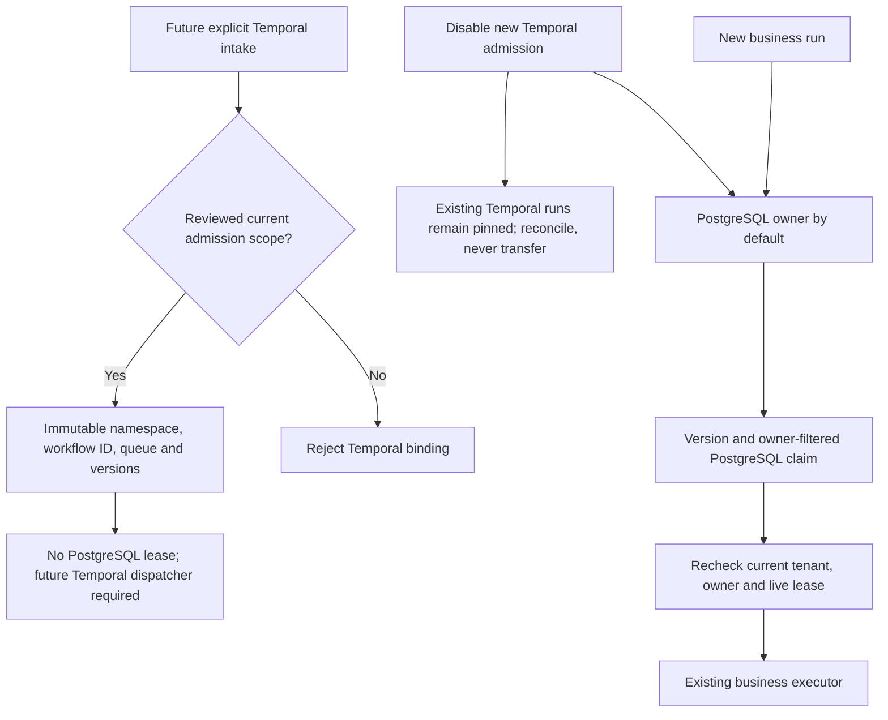

# Single workflow ownership: PostgreSQL fence before Temporal rollout

Local checkpoint, 24 October 2026. Migration **026** adds immutable orchestration
bindings to the actual `agent_runs` and `coding_runs` tables. It does not start a
Temporal server/worker, call a provider, dispatch a workflow or change production.
Both admission rows are **disabled by default**. Existing intake still creates
PostgreSQL-owned runs; Temporal intake/dispatch integration is not yet implemented.

## Enforced contract

- Owner is `postgres` or `temporal`. All five owner/binding fields are immutable
  after insertion. PostgreSQL rows have no Temporal fields; Temporal rows require
  them all. An existing queued/partial/failed run cannot be hot-transferred.
- A Temporal insert needs a fresh queued, undeleted, unstarted/unheartbeated run,
  matching reviewed namespace, queue, workflow/executor versions and current
  admission expiry within 24 hours. Coding attempt count must be zero. Admission
  is serialized against policy changes through a shared row lock.
- Workflow ID is exactly `gca.workspace.<run UUID>` or `gca.coding.<run UUID>`.
  Same UUIDs in separate business tables cannot alias. Namespace plus workflow ID
  is unique within each domain. Temporal tenant, run ID and executor version stay
  pinned after insertion.
- Database triggers reject PostgreSQL lease owner **or** expiry on Temporal rows,
  including updates attempted by pre-migration workers. Updated real workers also
  filter them out before `FOR UPDATE SKIP LOCKED`, so an old Temporal row cannot
  block ordinary PostgreSQL queue progress.
- Both business entrypoints recheck authoritative owner, tenant, version, deletion,
  phase and unexpired matching lease before starting heartbeats or loading provider/
  Google credentials. A rejected stale Workspace claim does not kill its worker
  loop or finalize a run now owned elsewhere.
- PostgreSQL queue compatibility before schema 026 is explicit. The claim checks
  for the migration control table within its transaction, using only closed SQL
  predicates. No model/request supplies SQL identifiers or an ownership override.

These fences do not prevent a privileged database administrator from changing
schema or dropping triggers. Generated code must remain keyless; DB credentials
and control-row updates remain trusted operator/controller authority, not tools
available to a model. Policy changes record old/new bounded configuration, database
actor and time in a separate audit table; no prompts/OAuth tokens belong there.

## Rollout and rollback

1. Back up the business ledger and apply the additive migration on approved hosting.
2. Deploy both updated PostgreSQL claimers and confirm owner visibility. An old
   worker is fenced by SQL but may otherwise repeatedly hit a rejected queue head;
   do not activate admission while old claimers remain.
3. Implement and validate deterministic Temporal workflows, typed keyless activities,
   dispatch recovery, stable request identity, retry/timeout limits, approval signals,
   cancellation, write reconciliation and version-pinned replay **before** enabling
   any Temporal intake. Current metadata bindings are not proof of that executor.
4. Admit only separately reviewed new requests with explicit scope and a short-lived
   control. Existing PostgreSQL work stays with its original owner.
5. Rollback stops **new** Temporal admission and keeps new ordinary intake on
   PostgreSQL. Existing Temporal work must finish/reconcile with its original
   workflow; do not copy it back to the old queue or retry uncertain writes.

Downgrade refuses while admission is enabled or **any retained Temporal-owned run**
exists, even terminal history. Export/preserve and reconcile that history under the
data-retention policy before considering schema removal; deleting production rows
is not an automatic rollback step. The policy audit survives downgrade/forward
repair. This conservative SQL guard cannot itself prove that external Temporal
history or pending activities are drained; live rollback requires that proof too.

## Evidence and open requirements

Eighteen focused local tests cover closed/expired/overlong admission, immutable
bindings, exact IDs/scope, old-worker lease rejection, actual concurrent disjoint
Workspace claims, actual coding claims, tenant/stale leases, both entrypoint fences,
worker-loop availability and rollback/audit forward repair. Disposable full-schema
upgrade-to-026/downgrade-to-002/upgrade-to-026 and empty-data retention passed;
all **1,893 coding regressions passed without skips** (54.09 seconds, one existing
Google SDK deprecation warning). Targeted lint, medium/high security and whitespace
checks passed. No production DB is used.

No Temporal SDK workflow, server, worker, admission UI, dispatch recovery, signals,
replay, activity idempotency, crash/load/traffic migration or live proof is claimed.
Those are still unchecked Sprint 62 requirements. The Kafka outbox/consumer is a
separate visibility plane and cannot grant business ownership or write authority.

The next schema-027 checkpoint supplies [transactional start intents and a bounded
SDK adapter](TEMPORAL_START_DELIVERY.md). It closes the local database-to-start
delivery contract with default-off transport; it does not supply the still-missing
business workflows, activities, replay or live service proof described above.
