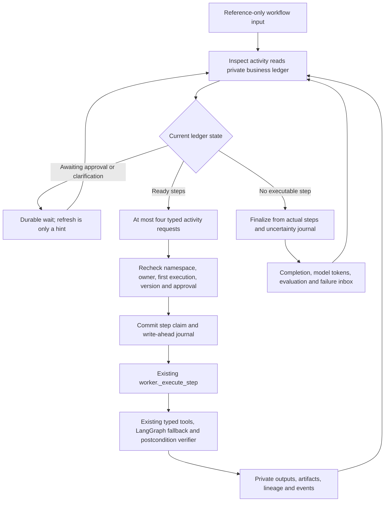

# Workspace Temporal workflow and existing executor bridge

Local checkpoint, 24 October 2026. Schema **028** and the optional SDK now provide
the first actual Workspace workflow/activities, not just an owner field or startup
queue. Admission and startup transport remain **off**. No live Temporal service or
worker is running, and ordinary production intake is unchanged.

## Deterministic outer loop, dynamic existing business logic

`WorkspaceWorkflow`, registered as `gca.workspace.v1`, uses only Temporal activities,
timers, signal/query state and reference contracts. It never imports the database,
Google tools, model clients, private prompts or raw tool results into the workflow
sandbox. The actual SDK sandbox successfully prepares it, and the real data
converter round-trips the startup dictionary into its typed input.

An inspection activity selects ready steps from the existing dependency DAG in
SQL. The outer workflow does not implement Gmail/Chat/Calendar lexical shortcuts:
it passes step UUIDs to the same executor already used by the PostgreSQL worker.
That executor retains deterministic typed operations, bounded agent fallback,
current model policy, exact dependency context, write contracts and read-after-write
verification. Model/OAuth access happens only inside the trusted activity process.
Generated code still belongs in the separate keyless coding broker.

Metadata activities have three bounded retry attempts. Business step activities
have **one automatic attempt**, five-minute execution and 30-second heartbeat
timeouts. At most four execute concurrently per worker; this is not global fairness
or a load-tested capacity promise. The workflow bounds its lifecycle to 256 cycles
and a 23-hour internal deadline, beneath the startup controller's 24-hour ceiling.
Metadata transient failures wait/retry within that bound; invalid bindings fail
closed without provider access. `refresh` carries no approval, content or tool
authority: the workflow rereads the authenticated private ledger. Signals arriving
during inspection are not lost when entering a wait.

## Step admission and the write boundary

Activities verify actual SDK namespace, workflow type/ID, queue, workflow and executor
versions against the current run. The acknowledged first execution run ID must match
before any business tool. A workflow that started before its startup ACK arrived
waits for that receipt. Continue-as-new chains are not silently accepted by v1.

A row-locked step claim checks dependencies and current typed-plan approval before
creating `temporal_workspace_steps`. The journal commits **before** credentials or
provider invocation. It stores only stable IDs, activity lineage, a nonce, read/write
classification and state—not source bodies or tokens. Private results remain in
the existing business tables; activities return only a short state string.

A redelivered completed activity returns the journal result. A duplicate while an
earlier execution may still be running becomes uncertain and cannot invoke another
tool. Cancellation, unknown failures and worker loss preserve this uncertainty.
The earlier process may still finish a remote call: a timeout/cancellation is not
proof that an email was not sent. A late completion cannot overwrite uncertain
journal state or restore false 100% success. No automatic read retry or write retry
is introduced by this bridge; approved safe-retry generations and reconciliation
are separate unfinished work.

Credential context is scoped and reset after each activity. The binding is checked
again immediately before credentials. Heartbeats expose only a step UUID and update
the private run timestamp. Cleanup is bounded; unresolved history blocks schema
downgrade. Hard private-data erasure nulls parent links but retains only reference
obligations, never reconstructed content.

## Truthful finalization and existing approval path

Finalization recomputes all completion measures from persisted steps, collects actual
model-call usage, emits a run event in the same transaction and updates the existing
evaluation/failure-inbox mechanism. Terminal observation retries these idempotent
fact projections. Empty/blocked plans do not complete successfully. Executing or
uncertain journal entries prevent functional/user-visible 100%, even when a late
step output exists. Verified artifacts remain in the existing recovery UI.

Clarification and approval SQL now preserves a Temporal run's immutable executor
pin. PostgreSQL runs retain the historical current-control repinning behavior,
including compatibility before schema 026. A real approval test invokes the
existing `decide_run` function across a different configured deployment version.
The step activity independently checks the approved hash of the current typed plan.

`build_workspace_worker` constructs an explicit optional SDK worker with fixed
workflow/activity registrations, four activity/workflow-task slots, a bounded cache
and graceful shutdown. It starts no process or connection merely by import. A
caller still needs an approved server/client, namespace credentials, private app
graph and database connection. There is no coding workflow registered yet.

## Verified evidence and open requirements

Twelve focused local tests cover actual SDK sandbox preparation and data conversion,
the real informational `_execute_step` path, full-schema business completion,
credential/model non-use, wrong/missing startup lineage, unknown failure, activity
cancellation, concurrent duplicate delivery, late success containment, erasure,
approval/version pinning, failure/evaluation idempotency and SDK-compatible bounded
worker registration. A direct workflow driver uses SDK activity test environments
and actual disposable PostgreSQL. It is **not a live Temporal service/history replay**.

The full disposable migration chain upgrades to 028, downgrades to 002, upgrades
again and passes empty-data retention. No production database was used.

Final checkpoint verified before the 25-October handoff: **1,918 coding tests passed
without skips** in 55.85 seconds. Seven warnings were reported: one existing Google
SDK deprecation and six Python warnings from existing process-death tests using
`fork()` after SDK initialization made the parent multithreaded. No hang occurred;
dedicated process isolation for those probes remains test-hardening work, not a
claim that multithreaded fork is safe. Targeted lint/security/whitespace checks
passed. These checks do not establish real server replay or live Google effects.

Still required before activation or claiming Sprint 62 complete:

- Actual local/approved-server startup, history replay, restart, cancellation and
  write fault-injection proofs, then measured live canary/load/rollback evidence.
- Durable authenticated API-to-signal delivery and admission UX. Current approval
  writes are compatible; no UI signal publisher has yet been activated. Waiting
  workflows recheck at their bounded timeout if no refresh is delivered.
- Safe-retry/reconciliation generations for failed/uncertain steps, artifact
  compensation, workflow expiry reconciliation and data/history retention.
- Coding workflow activities and their separate authority boundary.
- Deployment/version routing, global/per-tenant fairness/backpressure, shared
  capacity and separately approved hosting cost/failure-domain placement.

Current code does not claim these proofs or enable transport to compensate for their
absence. See [single-owner migration](WORKFLOW_OWNERSHIP.md) and
[transactional startup delivery](TEMPORAL_START_DELIVERY.md).

The following schema-029 checkpoint adds
[transactional API-to-refresh delivery](TEMPORAL_REFRESH_DELIVERY.md), including
the actual existing approval transaction. Capture remains off and no publisher
runs. This supersedes only the historical absence of signal-delivery code, not
the live server, replay, reconciliation or activation gates above.

Schema 030 adds [source-bound verified-completion recovery](TEMPORAL_VERIFIED_RECOVERY.md)
through the actual resume helper. Original uncertainty remains; deterministic
readback can append an expiring resolution. Retry generations, lost-worker
quiescence, compensation and real server/replay evidence remain open.
